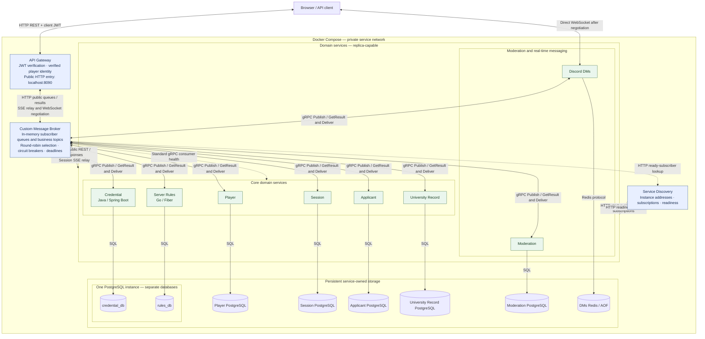

# Student ID, please

A distributed, microservice-based multiplayer game about moderating a university
Discord server. A team of moderators receives applicants who want to join the
FAF community server. Applicants present credentials that may be expired, forged,
inconsistent or simply false. One player acts as the **Moderator** and speaks to
the applicant directly. The rest act as **Junior Moderators**, each holding a
different slice of the university's records, and must communicate their findings
before a decision is made.

Accept the right people, reject the wrong ones, uncover the impostors, and do not
traumatize Mr. Pumpkin with the emojis.

---

## Table of contents

1. [Team](#team)
2. [Service boundaries](#service-boundaries)
3. [Architecture diagram](#architecture-diagram)
4. [Technologies and communication patterns](#technologies-and-communication-patterns)
5. [Communication contract](#communication-contract)
   - [Surface map](#surface-map)
   - [Data management](#data-management)
   - [Applicant initialization](#applicant-initialization)
   - [Gateway routing](#gateway-routing)
   - [REST endpoints](#rest-endpoints)
   - [gRPC services](#grpc-services)
   - [WebSocket protocol](#websocket-protocol)
   - [Asynchronous events](#asynchronous-events)
   - [Task limits](#task-limits)
   - [Error envelope and status mapping](#error-envelope-and-status-mapping)
   - [Status endpoint and request tracing](#status-endpoint-and-request-tracing)
   - [Downloading system logs](#downloading-system-logs)
   - [Docker Hub images](#docker-hub-images)
   - [Running the system](#running-the-system)
   - [Testing with Postman](#testing-with-postman)
   - [Mocks in Lab 1](#mocks-in-lab-1)
   - [Communication contract: Lab 1 changes](#communication-contract-lab-1-changes)
6. [Repository structure](#repository-structure)
7. [Contribution guide](#contribution-guide)
8. [Project board](#project-board)
9. [Credential and Rules deployment](#credential-and-rules-deployment)

---

## Team

| Member | Java service | Go service |
| --- | --- | --- |
| Pascari Vasile | Player Service | Moderation Session Service |
| Bobeica Andrei | Applicant Service | University Record Service |
| Clima Marin | Credential Service | Server Rules Service |
| Gurev Andreea | Moderation Service | Discord DMs Service |

Every member implements one service in **Java** and one in **Go**, so each of us
works in both languages of the project. Bobeica owns both the applicant's claims
and the university's ground truth deliberately: they are two halves of the same
seeded generation, and keeping them under one owner prevents them from drifting
apart accidentally.

---

## Service boundaries

Each microservice encapsulates one area of functionality and owns its data
exclusively. No service reads another service's database. The "does not own"
line for each service is the boundary that keeps the system modular.

### Player Service

Owns the identity and long-term progression of the **real players**.

- Registration, authentication, profiles
- Friends and online presence
- XP, levels, rank progression
- Formation of moderation teams

Progression is driven by completed shifts, decision accuracy and disciplinary
actions, all reported by the Moderation Session Service at the end of a shift.

**Does not own:** anything about the fictional applicants trying to enter the
server. A player and an applicant are unrelated concepts.

### Moderation Session Service

Owns one **active moderation shift**.

- Creating and joining sessions
- Assigning the Moderator and Junior Moderator roles
- Starting and ending shifts
- Tracking the current applicant in the queue
- Number of applications processed, session score, penalties

At the end of a shift it determines the overall session result and publishes it
so the Player Service can apply progression.

**Does not own:** the correctness of any individual decision, which belongs to
the Moderation Service, nor permanent player progression.

### Applicant Service

Owns the **people attempting to access the server**. It generates applicants with
a name, student ID, major, year, university status, courses and role.

Applicants may be FAF students, students from other majors, teaching assistants,
university staff, alumni or outsiders. Some intentionally provide false
information or attempt to impersonate another person.

**Does not own:** the truth. It owns only what the applicant *claims*. Whether
the claim matches reality is decided by comparison against the University Record
Service.

### Credential Service

Owns the **documents and credentials presented** by applicants: student ID,
university email, enrollment confirmation, course registration and similar.

Credentials can be expired, forged, inconsistent or incomplete. The service
validates the structure and authenticity of a credential.

**Does not own:** the admission decision. A perfectly valid document may still
belong to someone who is not allowed in.

### University Record Service

Owns the **hidden ground truth** of the university, used to verify applicants:
current enrollment list, Outlook group lists of emails, existing courses, current
academic year, semester schedule, FCIM server message record.

This information is deliberately partitioned among the junior moderator players.
One player may query the enrollment list while another can inspect the FCIM
server. Access is enforced per player and per session.

**Does not own:** applicant claims or credentials. It holds reality, not
assertions about it.

### Server Rules Service

Owns the **current rules for accessing the major's Discord server** and evaluates
applicants against them. Rules change between shifts and become progressively
more complicated. For example:

- Only FAF students may join
- First-year students may access `#general` but not `#dark-memes` or `#groupa`
- Students must be enrolled in FAF for at least 2 years
- Professors may access the teacher channels
- Previously banned students cannot enter regardless of their credentials

**Does not own:** the decision itself. It answers "which rules does this applicant
violate", not "let them in".

### Moderation Service

Owns the **admission decision** for each applicant. The Moderator may:

- **Accept** — allow the applicant into the Discord server
- **Reject** — deny access
- **Flag** — send the applicant for further investigation
- **Ban** — permanently prevent access

It gathers the relevant information, determines whether the decision was correct
according to the current server rules, and records the applicant, the decision,
the violated rules, the penalty and the outcome.

**Does not own:** applicant generation, credential validity or the rules
themselves. It consumes all three.

### Discord DMs Service

Owns the **real-time communication** between the moderator and the junior mods.
Players communicate through a Discord-like interface over WebSockets. Channels
are scoped to the current moderation session, for example `#enrollment-check`,
`#faculty-check`, `#course-registration`, `#general-mod-chat`.

Different players have access to different channels and different information.

**Does not own:** the correctness of anything said in a channel. The service
transports messages and does not determine whether the information is true.

---

## Architecture diagram

Editable source: [docs/architecture.mmd](docs/architecture.mmd). This shows the
coordinated Lab 4 source/configuration, not proof that all releases are deployed.
All eight business-delivery groups now select gRPC in the coordinated catalog.
See [release provenance and publication gates](deployment/releases.json).



Solid connections carry application/data traffic; dashed connections carry
registration, lookup or health control-plane traffic. Session SSE returns
Session → Broker → Gateway → client on the HTTP connection. WebSocket negotiation
uses Gateway/Broker, then the client connects directly to the selected DMs instance.
Responses return on their original connections, not independent service calls.

---

## Technologies and communication patterns

| Component | Implementation | Persistent storage | Interfaces |
| --- | --- | --- | --- |
| Player | Java / Quarkus | Own PostgreSQL | Public REST; private Broker gRPC |
| Session | Go / Fiber | Own PostgreSQL | Public REST/SSE; private Broker gRPC |
| Applicant | Java / Quarkus | Own PostgreSQL | Public REST; private Broker gRPC |
| Credential | Java / Spring Boot | credential_db | Public REST; private Broker gRPC |
| University Record | Go / Fiber | Own PostgreSQL | Public REST; private Broker gRPC |
| Server Rules | Go / Fiber | rules_db | Public REST; private Broker gRPC |
| Moderation | Java / Quarkus | Own PostgreSQL | Public REST; private Broker gRPC |
| Discord DMs | Go / Gorilla WebSocket | Own Redis / AOF | Public REST/direct WebSocket; private Broker gRPC |
| API Gateway | Python / FastAPI | None | JWT verification, HTTP public queues, SSE relay, WebSocket negotiation |
| Service Discovery | Python / FastAPI | In-memory registry | HTTP instance/subscription registration and readiness |
| Custom Message Broker | Python / FastAPI | In-memory queues/results | HTTP public queues; gRPC business messaging; topic fan-out |

There is no RabbitMQ, Kafka or Traefik deployment. Broker owns instance selection,
round robin and circuit breakers. Gateway is the public entry point, not an
internal business router. Credential and Rules share a PostgreSQL process, not
tables or users. Each domain service accesses only its own storage.

Current transport contracts:
[queues/topics](docs/messaging-queues.md),
[gRPC](docs/messaging-grpc.md),
[per-group modes](contracts/proto/transports.json).
The older domain-specific protos later in this README are design history, not
a claim that those domain RPC servers are live. Durable Broker queues and a
dead-letter channel are not implemented here; service-owned outboxes are not
Broker persistence.

### Why these choices

**Java for the services with the richest domain model.** Applicant, Credential
and Moderation carry almost all of the game's rules, and those rules grow every
time we add a new kind of lie, a new document type or a new interaction between
them. Credential validation is the clearest case: document kinds form a natural
type hierarchy, and modelling them as a sealed interface with one record per
credential type plus Bean Validation constraints means adding a forged-document
variant is a new subclass the compiler checks, not another branch in a
conditional that grows until nobody can read it. The Moderation Service benefits
from the same property, since a decision's correctness depends on combining
claims, credentials and rule violations, and an exhaustive `switch` over sealed
types fails to compile when we add a case we forgot to handle. Player Service is
Java for a narrower reason: Spring Security gives us registration, password
hashing, and JWT issue and refresh as configuration rather than code, and
authentication is the one part of this project we do not want to hand-roll.

The cost is real and we accept it. Four JVMs use noticeably more memory than four
Go processes, and Spring Boot's startup time makes a full `docker compose up`
slower than it would otherwise be. We considered Quarkus to reduce both and will
switch if local development becomes painful, but chose the more familiar stack
first because correctness of the domain logic matters more to this lab than
container startup speed.

**Go for the services dominated by connections and concurrency.** Discord DMs
holds one WebSocket per player for the length of a shift and fans every message
across four channels with per-player access filtering; goroutines and channels
make that a few dozen lines instead of a thread pool and a callback tangle. The
Session Service runs the live shift timer, the applicant queue and the session
state that every player polls, so it is the most read-heavy service in the
system. University Record serves many small partitioned lookups during a shift,
each one cheap and each one needing an access check. Server Rules is evaluated on
every single decision and benefits from a compiled, allocation-light path.

What we give up is expressiveness in the data layer. These four services have
simple schemas — records, rules, messages, session state — so the verbosity of
Go's error handling and the absence of an ORM costs us little here, which is
exactly why these four and not the other four.

**REST at the edge, gRPC between services.** The client is a browser game, so
everything it touches directly is REST over HTTP/JSON: readable in the network
tab, testable with curl, no proxy layer needed. Between services we use gRPC,
because those calls happen while a player is waiting and protobuf gives us both a
smaller wire format and generated stubs on both sides. The stubs matter more than
the latency: with a Java service calling a Go service, a single `.proto` file is
the only definition of the contract, and a field renamed on one side fails to
compile on the other instead of silently arriving as `null` at runtime.

We rejected gRPC everywhere because browsers cannot speak it without a gRPC-Web
proxy, which would add a component for no gain. We rejected REST everywhere
because the in-shift call chain — session to applicant, moderation to rules,
moderation to credential — would pay JSON serialisation three times per applicant
and, more importantly, would leave the Java/Go boundary defined only by prose in
this file.

**Events for anything not on the critical path.** Applicant initialization and
end-of-shift progression are asynchronous. Nobody is blocked waiting for XP to be
awarded, and coupling a shift's completion to the Player Service being up would
make a game fail for a cosmetic reason. We accept eventual consistency here: a
player may see their new level a second late, which does not affect play.

**Redis in two places.** As the session cache for live shift state, which is read
constantly and is rebuildable from PostgreSQL, and as the pub/sub backbone for
the Discord DMs Service so we can run more than one WebSocket instance without
players in the same session landing on different processes and losing each other.

---

## Communication contract

Lab 3's additive internal control-plane API is documented in the
[Service Discovery startup registration contract](docs/service-discovery-registration.md).
Credential and Rules are its initial callers. The
[scaled deployment and instance-routing guide](docs/service-discovery-scaled.md)
describes Lab 3 Grade 5, controlled instance removal and cross-instance streams.
It updates the shared `docker-compose.yml`; public business routes remain unchanged.

**Lab 4 service calls through the message broker.** Business calls between services use
HTTP/JSON through the message broker (Grade 5 moved them, with round-robin load balancing and
the circuit breaker, from the Gateway's service route), as listed in the shared
[HTTP operation catalog](docs/http-operation-catalog.md)
([`contracts/http/`](contracts/http/service-operations.json)). The receiving owner defines
each operation; operations still marked `requested` there are not working end to end. The
protobuf and RabbitMQ descriptions below are design context, not implemented transport.

**Player/Session review candidate:** the [real business baseline](docs/player-session-http-baseline.md)
documents real login/teams, persisted membership/access, score/decision receipts and
completion/progression delivery through Gateway. It extends the same executable catalog.
Source awaiting review is separate from the pinned Lab 3 images; unresolved Credential initialization and cross-owner context semantics prevent
a full-game readiness claim.

Lab 4 Task 3 documents the new custom Message Broker repository only. It adds no
broker endpoint, subscription, discovery field or protobuf definition and changes
no existing REST path or event payload. The broker's transport and queue contract
must be agreed alongside its later implementation; no new broker URL is required
by the Applicant or University Record collections at this stage.

### Surface map

Every service exposes at most three kinds of surface. This table is the index;
each surface is specified in full below.

| Service | REST (via gateway) | gRPC (internal) | Events published |
| --- | --- | --- | --- |
| Player | auth, profiles, friends, teams | — | `PlayerProgressed` |
| Moderation Session | sessions, roles, shift control | `SessionService` | `ShiftStarted`, `SessionCompleted` |
| Applicant | Lab 1 applicant CRUD | `ApplicantService` (planned) | `ApplicantInitialized` (planned) |
| Credential | credential read for the moderator UI | `CredentialService` | `ApplicantInitialized` |
| University Record | partitioned record lookups | `RecordService` | `ApplicantInitialized` |
| Server Rules | current ruleset read | `RulesService` | `RulesUpdated` |
| Moderation | decision submission, history | — (HTTP: `moderation.applicantDecisionFacts`) | `DecisionRecorded` (HTTP callback) |
| Discord DMs | channel list, history | — (HTTP: `dms.shiftStarted`, `dms.decisionRecorded`) | — |

Applicant's existing Lab 1 CRUD API is available through Gateway at
`/api/v1/applicants`. In the planned game flow, the client receives the current
applicant through the Session Service, which owns the queue and its current item.

### Data management

Each service owns a **private database**. No shared tables, no cross-service
joins, no direct connections to another service's store. Data crosses a boundary
only through an endpoint or an event.

The critical consequence for this game: the **Applicant Service holds what the
applicant claims**, and the **University Record Service holds what is actually
true**. These are deliberately separate databases that can disagree. That
disagreement is the entire game. If they shared storage, an impostor would be
impossible to model.

Consistency is **eventual** between services and **strong** within a service. An
applicant is fully initialized across the three owning services before it is
offered to the session queue; the session polls for readiness rather than
assuming it.

Access control on the University Record Service is enforced per session and per
player. Every read is checked against the record assignment for that shift, so a
junior moderator cannot query records they were not given.

**Deployment note.** The intended full-team setup uses separate databases and
credentials for each PostgreSQL-backed service. The current Lab 1 Compose file
deploys four services: Credential and Server Rules use separate databases in one
PostgreSQL container, Moderation uses its own PostgreSQL container, and Discord
DMs uses Redis. No service reads another service's database.

### Applicant initialization

Any of the three applicant-owning services may be contacted first for a new
applicant. Whichever one receives the request becomes the **initiator**:

1. The initiator generates its own part of the applicant and assigns the
   `applicantId`.
2. It publishes `ApplicantInitialized` containing the shared seed information.
3. The other two services consume the event and generate their own part,
   consistently with the seed.

If a service is contacted for an `applicantId` it has already received an event
for, it returns the stored data rather than generating anything. Generation is
therefore idempotent and the three parts of an applicant never contradict each
other by accident — only when the game intends them to.

```
Case A: Applicant Service first
  Applicant → ApplicantInitialized → Credential, University Record

Case B: Credential Service first
  Credential → ApplicantInitialized → Applicant, University Record

Case C: University Record Service first
  University Record → ApplicantInitialized → Applicant, Credential
```

The event carries a `deception` block describing the intended inconsistency, so
that the lying is coordinated rather than random:

```json
{
  "applicantId": "a3f1...",
  "seed": 918273,
  "initiator": "applicant-service",
  "identity": { "name": "Vlad Cebotari", "studentId": "FAF-221", "year": 2 },
  "deception": { "type": "IMPERSONATION", "impersonatedStudentId": "FAF-213" }
}
```

`deception.type` is one of `NONE`, `IMPERSONATION`, `FORGED_DOCUMENT`,
`EXPIRED_DOCUMENT`, `INCONSISTENT_CLAIM`, `NOT_ENROLLED`, `PREVIOUSLY_BANNED`.

---

### Gateway routing

Every client-to-service REST call enters the system through the **Gateway**, which
forwards it to the service owning the path and keeps the `/api/v1` prefix exactly as
specified below. A client therefore has one address for the whole system instead of one
per service, and a service's host port is an implementation detail rather than part of the
contract.

| Path prefix | Service | Routed |
| --- | --- | --- |
| `/api/v1/players`, `/api/v1/teams` | Player | owner to add |
| `/api/v1/sessions` | Moderation Session | owner to add |
| `/api/v1/applicants` | Applicant Lab 1 CRUD | yes |
| `/api/v1/credentials` | Credential | yes |
| `/api/v1/records`, `/api/v1/university-records` | University Record | yes |
| `/api/v1/rules` | Server Rules | yes |
| `/api/v1/decisions` | Moderation | yes |
| `/api/v1/penalty-policies` | Moderation | yes |
| `/api/v1/channels` | Discord DMs | yes |
| `/api/v1/messages` | Discord DMs | yes |

The released Credential and Rules images have no outbound REST business-service
calls: their integration dependencies remain fixtures/plans. Their direct Discovery
registration is control-plane traffic; client CRUD uses Gateway. The unmerged
[owned business HTTP candidate](docs/owned-business-http-baseline.md) removes
fixtures from production artifacts and implements protected-read membership calls
through Gateway, plus persisted generation/provenance, recoverable initialization
and ID-based Rules evaluation consumers. It is not deployed or integration-ready:
peer consumer-port agreement, exact Gateway bindings and real multi-service
acceptance remain outstanding. Discovery's current dev needs no domain calls.
For the latest merged catalog and the incompatible Applicant/Record initialization
draft, read the [owned contract reconciliation](docs/owned-contract-reconciliation.md)
before connecting these candidates. The private service PRs remain draft.
Latest compatibility work uses Applicant/Record's explicit adapter handoff at
`42f69b9`; see the [pre-migration compatibility gate](docs/owned-peer-compatibility.md).
The 39-operation candidate includes the missing initialization/context/callback
and batch-validation routes. It does not establish real-owner acceptance or
authorize promotion of images/pins or migration of our callers to Broker.
The subsequent [owned Task 5 migration candidate](docs/owned-broker-migration.md)
switches Credential/Rules outbound calls to required Broker settings without a
Gateway fallback. It preserves public Gateway access and leaves shared load
balancing/circuit-breaker work to its owner. Source migration is not live acceptance.

A prefix matches only on a segment boundary. The method, path, query string, body and
headers reach the service with the credential/identity handling described below,
and its status, body and headers are relayed back
unchanged, error envelope included, so a service's own `404` or `422` is not rewritten by
the Gateway. Hop-by-hop headers are dropped on each hop.

`X-Trace-Id` is reused when the caller sends one and generated when it does not. It is
forwarded to the service and returned on every response, so one id spans both hops.

**What does not go through the Gateway.**

| Traffic | Reason |
| --- | --- |
| Service-to-service business calls | Routed by the message broker, see the [HTTP operation catalog](docs/http-operation-catalog.md). |
| `/api/v1/internal/...` on Discord DMs | Removed from DMs; its internal operations are reached only through the message broker (see the catalog). |
| `WS /ws/v1/sessions/{sessionId}` | The Gateway returns a direct DMs URL through the negotiation endpoint below; the socket itself stays direct. |

The gRPC/event game integrations remain planned or in-process fixtures in the
current releases; their contracts do not establish live transport. The additive
[Lab 4 Gateway membership baseline](docs/gateway-membership-baseline.md) prepares
real Record and Discord DMs calls through Gateway to persisted Session permissions.
Its service-only `POST /internal/v1/session-memberships/verify` operation uses
dedicated caller and target credentials. Gateway binds public `X-Player-Id` to the
verified player JWT subject. Session adds host-only
`PUT /api/v1/sessions/{sessionId}/access` for explicit stored record/channel
assignments. This is a candidate contract and verification harness: the existing
shared image pins and Compose deployment still select the previous releases.
Discovery registration stays direct. The [Applicant/Record migration](docs/applicant-record-broker-migration.md)
now routes their business and membership calls through Message Broker, with unchanged
wire contracts and an opt-in deployment overlay. Gateway retains public routing.
The matching broker catalog/image and actual current-peer acceptance remain required;
queue/topic delivery is introduced by the shared
[Task6 candidate](docs/messaging-queues.md); each owner must still adopt it.

Lab 4 Grade 5 then moved every service operation, together with load balancing and circuit
breaking, from the Gateway to the message broker; the [HTTP operation catalog](docs/http-operation-catalog.md)
lists every business call: Moderation calls Session, Applicant, Credential and Rules and delivers
`DecisionRecorded` to Session and DMs as authenticated HTTP callbacks; Session delivers
`ShiftStarted` to DMs; Rules may read Moderation's decision facts. Each operation's status
there says whether its owner has implemented it; `requested` operations do not work end to
end yet.

The Gateway adds three failure codes of its own, each carrying
`"service": "gateway-service"`:

| HTTP | Code | Condition |
| --- | --- | --- |
| 404 | `ROUTE_NOT_FOUND` | No service is routed for this path. |
| 503 | `UPSTREAM_TIMEOUT` | The service did not answer within the Gateway's read timeout. |
| 503 | `UPSTREAM_UNAVAILABLE` | The service could not be reached. |

---

### REST endpoints

All REST paths are prefixed `/api/v1` and are reached through the
[Gateway](#gateway-routing). Bodies are JSON. Authenticated endpoints require
`Authorization: Bearer <token>`.

#### Player Service

Registration and profile updates return `409 PLAYER_ALREADY_EXISTS` for
case-insensitive conflicts, including concurrent requests across replicas.
See the [reliability and schema-upgrade notes](docs/owned-service-reliability.md).

```
POST /api/v1/players/register
Request:  { "username": "string", "email": "string", "password": "string" }
Response: 201 { "playerId": "uuid", "username": "string", "level": 1, "xp": 0 }
Errors:   409 username or email taken | 422 validation failed
```

```
POST /api/v1/players/login
Request:  { "email": "string", "password": "string" }
Response: 200 { "accessToken": "jwt", "refreshToken": "jwt", "expiresIn": 3600 }
Errors:   401 invalid credentials
```

```
POST /api/v1/players/refresh
Request:  { "refreshToken": "jwt" }
Response: 200 { "accessToken": "jwt", "expiresIn": 3600 }
Errors:   401 expired or revoked refresh token
```

```
GET /api/v1/players/{playerId}
Response: 200 {
  "playerId": "uuid", "username": "string", "level": 7, "xp": 3420,
  "rank": "SENIOR_MODERATOR", "shiftsCompleted": 41, "accuracy": 0.86,
  "disciplinaryActions": 2, "online": true
}
Errors:   404 player not found
```

```
PUT /api/v1/players/{playerId}
Request:  { "username": "string", "email": "string" }
Response: 200 { "playerId": "uuid", "username": "string", "level": 7, "xp": 3420 }
Errors:   404 player not found | 409 username or email taken | 422 validation failed
```

```
DELETE /api/v1/players/{playerId}
Response: 204 No Content
Errors:   404 player not found
```

```
POST /api/v1/players/{playerId}/friends
Request:  { "targetPlayerId": "uuid" }
Response: 202 { "status": "PENDING" }
Errors:   404 player not found | 409 already friends or request pending
```

```
GET /api/v1/players/{playerId}/friends
Response: 200 { "friends": [ { "playerId": "uuid", "username": "string", "online": true } ] }
```

```
POST /api/v1/teams
Request:  { "name": "string", "ownerId": "uuid" }
Response: 201 { "teamId": "uuid", "name": "string", "members": ["uuid"] }
Errors:   409 team name taken
```

```
POST /api/v1/teams/{teamId}/members
Request:  { "playerId": "uuid" }
Response: 200 { "teamId": "uuid", "members": ["uuid"] }
Errors:   404 team not found | 409 already a member | 422 team full
```

#### Moderation Session Service

Database failures return `503 DATABASE_UNAVAILABLE`, including SSE handshakes;
genuine missing sessions remain `404 SESSION_NOT_FOUND` and task deadlines remain
`504 TASK_TIMEOUT`. See the [owned-service reliability notes](docs/owned-service-reliability.md)
for the unchanged error envelope and transaction/event behavior.

```
POST /api/v1/sessions
Request:  { "teamId": "uuid", "hostPlayerId": "uuid", "difficulty": "EASY|NORMAL|HARD" }
Response: 201 {
  "sessionId": "uuid", "state": "LOBBY", "hostPlayerId": "uuid",
  "players": [ { "playerId": "uuid", "role": "UNASSIGNED" } ]
}
Errors:   404 team not found | 409 team already in a session
```

```
POST /api/v1/sessions/{sessionId}/join
Request:  { "playerId": "uuid" }
Response: 200 { "sessionId": "uuid", "players": [ { "playerId": "uuid", "role": "UNASSIGNED" } ] }
Errors:   404 session not found | 409 session already started | 422 session full
```

```
POST /api/v1/sessions/{sessionId}/roles
Request:  { "assignments": [ { "playerId": "uuid", "role": "MODERATOR|JUNIOR_MODERATOR" } ] }
Response: 200 {
  "sessionId": "uuid",
  "players": [ { "playerId": "uuid", "role": "JUNIOR_MODERATOR",
                 "recordAccess": ["ENROLLMENT_LIST"], "channels": ["#enrollment-check"] } ]
}
Errors:   403 caller is not the host | 409 roles already assigned
          | 422 exactly one moderator required
```

```
POST /api/v1/sessions/{sessionId}/start
Response: 200 {
  "sessionId": "uuid", "state": "ACTIVE", "startedAt": "2026-09-08T18:00:00Z",
  "rulesetVersion": 12, "applicantsQueued": 10
}
Errors:   403 caller is not the host | 409 already started | 422 roles not assigned
```

```
GET /api/v1/sessions/{sessionId}
Response: 200 {
  "sessionId": "uuid", "state": "LOBBY|ACTIVE|COMPLETED",
  "currentApplicantId": "uuid", "applicationsProcessed": 4,
  "score": 340, "penalties": 1, "timeRemaining": 512
}
Errors:   404 session not found
```

```
PUT /api/v1/sessions/{sessionId}
Headers:  X-Player-Id: hostPlayerId
Request:  { "difficulty": "EASY|NORMAL|HARD" }
Response: 200 { "sessionId": "uuid", "state": "LOBBY", "difficulty": "HARD" }
Errors:   403 caller is not the host | 404 session not found
          | 409 session is not in LOBBY | 422 validation failed
```

```
DELETE /api/v1/sessions/{sessionId}
Headers:  X-Player-Id: hostPlayerId
Response: 204 No Content
Errors:   403 caller is not the host | 404 session not found
          | 409 session is not in LOBBY | 422 validation failed
```

```
GET /api/v1/sessions/{sessionId}/current-applicant
Response: 200 {
  "applicantId": "uuid", "position": 5, "remaining": 5,
  "profile": {
    "name": "Vlad Cebotari", "studentId": "FAF-221", "major": "FAF",
    "year": 2, "universityStatus": "ENROLLED", "role": "STUDENT",
    "courses": ["PAD", "SO", "AI"]
  }
}
Notes:    profile is relayed from the Applicant Service over gRPC
Errors:   404 session not found | 409 no applicant at the door
```

```
POST /api/v1/sessions/{sessionId}/next-applicant
Response: 200 { "applicantId": "uuid", "position": 5, "remaining": 5 }
Errors:   404 queue empty | 409 current applicant has no decision yet
```

```
POST /api/v1/sessions/{sessionId}/end
Response: 200 {
  "sessionId": "uuid", "state": "COMPLETED",
  "result": { "score": 780, "correct": 8, "incorrect": 2,
              "penalties": 1, "outcome": "PASSED" }
}
Errors:   409 session not active
```

#### Credential Service

```
GET /api/v1/credentials/applicant/{applicantId}
Headers:  X-Session-Id
Response: 200 {
  "applicantId": "uuid",
  "credentials": [
    { "credentialId": "uuid", "type": "STUDENT_ID", "issuedAt": "2024-09-01",
      "expiresAt": "2028-07-01",
      "fields": { "studentId": "FAF-221", "photoUrl": "string" } },
    { "credentialId": "uuid", "type": "UNIVERSITY_EMAIL",
      "fields": { "email": "vlad.cebotari@isa.utm.md" } }
  ]
}
Notes:    what the applicant handed over, exactly as presented, with no verdict
Errors:   403 caller is not in this session | 404 applicant not found
```

```
GET /api/v1/credentials/types
Response: 200 { "types": ["STUDENT_ID", "UNIVERSITY_EMAIL",
                          "ENROLLMENT_CONFIRMATION", "COURSE_REGISTRATION"] }
```

```
POST /api/v1/credentials
Request:  { "applicantId": "uuid", "type": "STUDENT_ID", "issuedAt": "2024-09-01",
            "expiresAt": "2028-07-01", "fields": { "studentId": "FAF-221", "photoUrl": "string" } }
Response: 201 { "credentialId": "uuid", "applicantId": "uuid", "type": "STUDENT_ID", ... }
Errors:   400 malformed request | 422 invalid credential fields
```

```
GET    /api/v1/credentials/{credentialId}
PUT    /api/v1/credentials/{credentialId}
DELETE /api/v1/credentials/{credentialId}
Responses: 200 credential | 204 deletion complete
Errors:    404 credential not found
```

#### University Record Service

Every lookup requires `X-Session-Id` and `X-Player-Id`, and is rejected with 403
if that player was not assigned the corresponding record type for that shift.

```
GET /api/v1/records/enrollment?studentId=FAF-221
Headers:  X-Session-Id, X-Player-Id
Response: 200 {
  "found": true, "studentId": "FAF-221", "name": "Vlad Cebotari",
  "major": "FAF", "enrolledSince": "2024-09-01", "status": "ACTIVE"
}
Errors:   403 player not assigned to ENROLLMENT_LIST | 404 not enrolled
```

```
GET /api/v1/records/outlook-groups?email=vlad.cebotari@isa.utm.md
Headers:  X-Session-Id, X-Player-Id
Response: 200 { "found": true, "groups": ["FAF-221", "FCIM-STUDENTS"] }
Errors:   403 player not assigned to OUTLOOK_GROUPS
```

```
GET /api/v1/records/courses?semester=2026-1
Headers:  X-Session-Id, X-Player-Id
Response: 200 { "semester": "2026-1",
                "courses": [ { "code": "PAD", "name": "Distributed Systems", "year": 3 } ] }
Errors:   403 player not assigned to COURSE_CATALOG
```

```
GET /api/v1/records/fcim-messages?studentId=FAF-221
Headers:  X-Session-Id, X-Player-Id
Response: 200 { "messages": [ { "channel": "#general",
                                "sentAt": "2026-03-04T10:22:00Z", "excerpt": "string" } ] }
Errors:   403 player not assigned to FCIM_RECORD
```

```
GET /api/v1/records/academic-context
Response: 200 { "academicYear": "2026/2027", "semester": "2026-1", "weekOfSemester": 3 }
Notes:    unrestricted; every player may see the calendar
```

#### Server Rules Service

```
GET /api/v1/rules/current?sessionId={sessionId}
Response: 200 {
  "rulesetVersion": 12,
  "rules": [
    { "code": "FAF_ONLY", "description": "Only FAF students may join",
      "severity": "CRITICAL" },
    { "code": "MIN_2_YEARS",
      "description": "Must be enrolled in FAF for at least 2 years",
      "severity": "MAJOR" },
    { "code": "NO_BANNED",
      "description": "Previously banned students cannot enter",
      "severity": "CRITICAL" }
  ]
}
Errors:   404 session not found
```

```
POST /api/v1/rules
Request:  { "code": "MIN_2_YEARS", "description": "Must be enrolled for at least 2 years",
            "type": "MIN_ENROLLMENT_YEARS", "severity": "MAJOR", "active": true,
            "minimumYears": 2 }
Response: 201 { "ruleId": "uuid", "code": "MIN_2_YEARS", ... }
Errors:   400 malformed request | 422 invalid rule
```

```
GET    /api/v1/rules
GET    /api/v1/rules/{ruleId}
PUT    /api/v1/rules/{ruleId}
DELETE /api/v1/rules/{ruleId}
Responses: 200 rule or list | 204 deletion complete
Errors:    404 rule not found
```

```
POST /api/v1/rules/evaluate
Request:  { "applicantId": "uuid", "major": "FAF", "enrollmentYears": 2,
            "role": "STUDENT", "previouslyBanned": false, "requestedChannel": "#general" }
Response: 200 { "applicantId": "uuid", "rulesetVersion": 1, "violations": [],
                "recommendedAction": "ACCEPT" }
Errors:   400 malformed request | 422 invalid applicant data
```

#### Moderation Service

```
POST /api/v1/decisions
Request:  {
  "sessionId": "uuid", "applicantId": "uuid", "moderatorId": "uuid",
  "action": "ACCEPT|REJECT|FLAG|BAN", "reason": "string"
}
Response: 201 {
  "decisionId": "uuid", "correct": false,
  "expectedAction": "REJECT", "violatedRules": ["MIN_2_YEARS"],
  "penalty": 50, "scoreDelta": -50, "sessionScore": 290
}
Errors:   403 caller is not the moderator | 404 applicant not found
          | 409 decision already recorded for this applicant
```

```
GET /api/v1/decisions/{decisionId}
Response: 200 { "decisionId": "uuid", "sessionId": "uuid", "applicantId": "uuid",
                "action": "REJECT", "correct": true, "violatedRules": [],
                "decidedAt": "2026-09-08T18:12:44Z" }
Errors:   404 decision not found
```

```
GET /api/v1/decisions/session/{sessionId}
Response: 200 { "sessionId": "uuid", "decisions": [ ... ],
                "correct": 8, "incorrect": 2 }
```

```
POST /api/v1/decisions/{decisionId}/appeal
Request:  { "playerId": "uuid", "argument": "string" }
Response: 200 { "decisionId": "uuid", "upheld": true, "penaltyRefunded": 0 }
Errors:   404 decision not found | 409 appeal window closed
```

#### Discord DMs Service

```
GET /api/v1/channels?sessionId={sessionId}&playerId={playerId}
Response: 200 { "channels": [ { "name": "#enrollment-check", "canWrite": true } ] }
Errors:   403 player not in session
```

```
GET /api/v1/channels/{channel}/history?sessionId={sessionId}&limit=50
Response: 200 { "channel": "#enrollment-check", "messages": [ ... ] }
Errors:   403 player has no access to this channel
```

---

### gRPC services

> **Lab 4 Grade 8, implemented contract:** service-to-service messaging over gRPC is
> [`contracts/proto/studentid/messaging/v1/messaging.proto`](contracts/proto/studentid/messaging/v1/messaging.proto),
> described in [docs/messaging-grpc.md](docs/messaging-grpc.md): `MessageBroker`
> (`Publish`, `GetResult`, `ListTopics`) and `MessageConsumer` (`Deliver`), carrying the
> reviewed JSON business bodies unchanged. The per-service protos below are the Lab 1
> design and were never implemented; they are kept for history only.

Proto files live in [`contracts/proto/`](contracts/proto) at the root of the CPR
and are consumed by every service, so Java and Go generate their stubs from the
same source of truth. `syntax = "proto3"` throughout; `package studentid.v1`.

#### `common.proto`

```protobuf
message Applicant {
  string applicant_id = 1;
  string name = 2;
  string student_id = 3;
  string major = 4;
  int32  year = 5;
  UniversityStatus university_status = 6;
  ApplicantRole role = 7;
  repeated string courses = 8;
}

enum UniversityStatus { STATUS_UNSPECIFIED = 0; ENROLLED = 1; GRADUATED = 2;
                        EXPELLED = 3; NEVER_ENROLLED = 4; }
enum ApplicantRole    { ROLE_UNSPECIFIED = 0; STUDENT = 1; TEACHING_ASSISTANT = 2;
                        STAFF = 3; ALUMNI = 4; OUTSIDER = 5; }
enum DeceptionType    { DECEPTION_UNSPECIFIED = 0; NONE = 1; IMPERSONATION = 2;
                        FORGED_DOCUMENT = 3; EXPIRED_DOCUMENT = 4;
                        INCONSISTENT_CLAIM = 5; NOT_ENROLLED = 6;
                        PREVIOUSLY_BANNED = 7; }
enum Severity         { SEVERITY_UNSPECIFIED = 0; MINOR = 1; MAJOR = 2; CRITICAL = 3; }
enum Action           { ACTION_UNSPECIFIED = 0; ACCEPT = 1; REJECT = 2; FLAG = 3; BAN = 4; }
```

#### `applicant.proto` — Applicant Service

```protobuf
service ApplicantService {
  rpc CreateApplicant (CreateApplicantRequest) returns (ApplicantResponse);
  rpc GetApplicant    (GetApplicantRequest)    returns (ApplicantResponse);
  rpc GetClaims       (GetApplicantRequest)    returns (ClaimsResponse);
  rpc GetDeception    (GetApplicantRequest)    returns (DeceptionResponse);
}

message CreateApplicantRequest {
  string session_id = 1;
  string difficulty = 2;   // EASY | NORMAL | HARD
  int64  seed = 3;
}
message GetApplicantRequest { string applicant_id = 1; }
message ApplicantResponse   { Applicant applicant = 1; }

message Claim          { string field = 1; string value = 2; }
message ClaimsResponse { string applicant_id = 1; repeated Claim claims = 2; }

message DeceptionResponse {
  string applicant_id = 1;
  DeceptionType type = 2;
  string impersonated_student_id = 3;
  repeated string inconsistent_fields = 4;
}
```

`GetDeception` is called only by the Moderation Service when scoring a decision.
It is never routed through the gateway and never reaches a client.

#### `credential.proto` — Credential Service

```protobuf
service CredentialService {
  rpc GenerateCredentials (GenerateCredentialsRequest) returns (CredentialsResponse);
  rpc GetCredentials      (ApplicantRef)               returns (CredentialsResponse);
  rpc ValidateCredential  (ValidateCredentialRequest)  returns (ValidationResponse);
}

message ApplicantRef               { string applicant_id = 1; }
message GenerateCredentialsRequest { string applicant_id = 1; int64 seed = 2; }

message Credential {
  string credential_id = 1;
  CredentialType type = 2;
  string issued_at = 3;                 // ISO-8601 date
  string expires_at = 4;
  map<string, string> fields = 5;
}
enum CredentialType { CREDENTIAL_UNSPECIFIED = 0; STUDENT_ID = 1;
                      UNIVERSITY_EMAIL = 2; ENROLLMENT_CONFIRMATION = 3;
                      COURSE_REGISTRATION = 4; }

message CredentialsResponse { string applicant_id = 1; repeated Credential credentials = 2; }

message ValidateCredentialRequest { string credential_id = 1; }
message ValidationResponse {
  string credential_id = 1;
  bool structurally_valid = 2;
  bool authentic = 3;
  repeated string issues = 4;   // SIGNATURE_MISMATCH, EXPIRED, MISSING_FIELD, ...
}
```

#### `record.proto` — University Record Service

```protobuf
service RecordService {
  rpc InitializeRecords   (InitializeRecordsRequest) returns (InitializeRecordsResponse);
  rpc LookupEnrollment    (EnrollmentQuery)          returns (EnrollmentResponse);
  rpc LookupOutlookGroups (EmailQuery)               returns (OutlookGroupsResponse);
  rpc ListCourses         (SemesterQuery)            returns (CoursesResponse);
  rpc LookupFcimMessages  (EnrollmentQuery)          returns (FcimMessagesResponse);
  rpc GetAcademicContext  (Empty)                    returns (AcademicContextResponse);
}

message Empty {}
message InitializeRecordsRequest  { string applicant_id = 1; int64 seed = 2; }
message InitializeRecordsResponse { string applicant_id = 1; repeated string records_created = 2; }

message EnrollmentQuery { string student_id = 1; string session_id = 2; string player_id = 3; }
message EmailQuery      { string email = 1;      string session_id = 2; string player_id = 3; }
message SemesterQuery   { string semester = 1;   string session_id = 2; string player_id = 3; }

message EnrollmentResponse {
  bool found = 1; string student_id = 2; string name = 3;
  string major = 4; string enrolled_since = 5; string status = 6;
}
message OutlookGroupsResponse   { bool found = 1; repeated string groups = 2; }
message Course                  { string code = 1; string name = 2; int32 year = 3; }
message CoursesResponse         { string semester = 1; repeated Course courses = 2; }
message FcimMessage             { string channel = 1; string sent_at = 2; string excerpt = 3; }
message FcimMessagesResponse    { repeated FcimMessage messages = 1; }
message AcademicContextResponse { string academic_year = 1; string semester = 2; int32 week_of_semester = 3; }
```

`session_id` and `player_id` are carried in the message rather than in metadata,
so the access check is part of the contract and cannot be forgotten by a caller.
Violations return `PERMISSION_DENIED`.

#### `rules.proto` — Server Rules Service

```protobuf
service RulesService {
  rpc GetCurrentRuleset (SessionRef)      returns (RulesetResponse);
  rpc Evaluate          (EvaluateRequest) returns (EvaluationResponse);
  rpc RotateRuleset     (RotateRequest)   returns (RotateResponse);
}

message SessionRef      { string session_id = 1; }
message Rule            { string code = 1; string description = 2; Severity severity = 3; }
message RulesetResponse { int32 ruleset_version = 1; repeated Rule rules = 2; }

message EvaluateRequest { string session_id = 1; string applicant_id = 2; }
message Violation       { string code = 1; Severity severity = 2; }
message EvaluationResponse {
  string applicant_id = 1;
  int32 ruleset_version = 2;
  repeated Violation violations = 3;
  Action recommended_action = 4;
}

message RotateRequest  { string session_id = 1; string difficulty = 2; }
message RotateResponse { int32 ruleset_version = 1; repeated string added = 2;
                         repeated string removed = 3; }
```

#### `moderation.proto` — Moderation Service

```protobuf
service ModerationService {
  rpc SubmitDecision       (SubmitDecisionRequest) returns (DecisionResponse);
  rpc GetDecision          (DecisionRef)           returns (DecisionResponse);
  rpc ListSessionDecisions (SessionRef)            returns (SessionDecisionsResponse);
}

message SubmitDecisionRequest {
  string session_id = 1; string applicant_id = 2; string moderator_id = 3;
  Action action = 4; string reason = 5;
}
message DecisionRef { string decision_id = 1; }
message DecisionResponse {
  string decision_id = 1; bool correct = 2; Action expected_action = 3;
  repeated string violated_rules = 4; int32 penalty = 5;
  int32 score_delta = 6; int32 session_score = 7; string decided_at = 8;
}
message SessionDecisionsResponse {
  string session_id = 1; repeated DecisionResponse decisions = 2;
  int32 correct = 3; int32 incorrect = 4;
}
```

#### `session.proto` — Moderation Session Service

```protobuf
service SessionService {
  rpc GetSessionState  (SessionRef)        returns (SessionStateResponse);
  rpc VerifyMembership (MembershipRequest) returns (MembershipResponse);
  rpc ApplyScoreDelta  (ScoreDeltaRequest) returns (SessionStateResponse);
}

message SessionStateResponse {
  string session_id = 1; string state = 2; string current_applicant_id = 3;
  int32 applications_processed = 4; int32 score = 5; int32 penalties = 6;
  int32 ruleset_version = 7; int32 time_remaining = 8;
}
message MembershipRequest  { string session_id = 1; string player_id = 2; }
message MembershipResponse {
  bool member = 1; string role = 2;
  repeated string record_access = 3; repeated string channels = 4;
}
message ScoreDeltaRequest { string session_id = 1; int32 delta = 2; int32 penalty = 3; }
```

`VerifyMembership` is what the Discord DMs Service and the University Record
Service call to enforce per-player access, so the assignment of records and
channels is decided in exactly one place.

**Player and Session Lab 1 mock contract.** These are typed, in-process fixtures
in the service source, not new REST/gRPC endpoints or live RabbitMQ consumers.
The mock Player team lookup returns
`{teamId, name, ownerId, members: [playerId]}`; unknown team/player IDs fail.
For the agreed fixture, team `66666666-6666-6666-6666-666666666666` has owner
`11111111-1111-1111-1111-111111111111` and the four members listed in
[Mocks in Lab 1](#mocks-in-lab-1). Session
`55555555-5555-5555-5555-555555555555` uses ruleset version `1` and a
one-item queue: applicant `a0000000-0000-0000-0000-000000000001`, seed
`918273`. This applicant-to-scenario mapping was chosen for Lab 1; the
applicant claims remain with the fake Applicant client and are relayed only
after it reports the applicant ready. Its profile is Vlad Cebotari, FAF-221,
major FAF, year 2, `ENROLLED` `STUDENT`, courses `PAD`, `SO`, `AI`, with
deception `NONE`.

For this session, `VerifyMembership` gives the Moderator all mock channels but
no record assignment; the juniors get `ENROLLMENT_LIST` and
`#enrollment-check`, `OUTLOOK_GROUPS` and `#faculty-check`, or
`COURSE_CATALOG` plus `FCIM_RECORD` and `#course-registration`, respectively.
All four get `#general-mod-chat`. Unknown session/player IDs and missing
permissions fail closed for both Record and Discord DMs checks.

The fixture's correct `ACCEPT` decision has ID
`d0000000-0000-0000-0000-000000000001`, score delta `+100`, and penalty `0`.
`ApplyScoreDelta` is the only score/penalty mutation; `DecisionRecorded` then
advances the queue and counts the decision without scoring it again. Repeated
delivery is deduplicated. Its completed result is processed `1`, correct `1`,
incorrect `0`, score `100`, penalties `0`, accuracy `1.0`, outcome `PASSED`.
`SessionCompleted.players` is an array of player UUIDs; `accuracy` is a
fraction from `0` to `1`, and `outcome` is `PASSED` or `FAILED`. For this
fixture, Player grants each listed player `+100` cumulative XP once per
`(sessionId, playerId)` and emits `PlayerProgressed.xp` as the **new total**.
The general XP formula remains Player-owned.

**Proposed additive contract fields (not yet agreed):** add UUID
`decision_id` to `ScoreDeltaRequest` to make retries idempotent by
`(session_id, decision_id)`, and add matching UUID `decisionId` to the
`DecisionRecorded` payload for correlation. The event envelope's `eventId`
remains separate. The current protobuf and event table above remain unchanged
until the producing/consuming owners agree to these additions.

---

### WebSocket protocol

#### Gateway negotiation (Grade 7 proposal)

Before opening the socket, the client requests
`GET /api/v1/ws/sessions/{sessionId}/negotiate?playerId={playerId}` from the
Gateway with `Authorization: Bearer <jwt>`. Both IDs are UUIDs. The response is
`200 { "webSocketUrl": "ws://localhost:8088/ws/v1/sessions/{sessionId}?playerId={playerId}&token={jwt}" }`
in the local Compose deployment. The client then connects to that URL **directly**;
the Gateway does not hold a WebSocket connection.

`DMS_PUBLIC_WS_ORIGIN` configures the browser-reachable `ws://` or `wss://`
origin used in the response. The local default is `ws://localhost:8088`; remote
deployments must use their public host and TLS. The Gateway does not derive it
from the request Host header. The response uses `Cache-Control: no-store`
because it includes the JWT. The Gateway checks the Bearer header's presence,
not the JWT's validity or session membership; Discord DMs still decides those
at the WebSocket handshake. Missing/malformed Bearer headers return the shared
`401 UNAUTHENTICATED` envelope; invalid or duplicate UUID inputs return
`400 INVALID_SESSION_ID` or `400 INVALID_PLAYER_ID`. This is a proposed
cross-service contract pending Gateway and DMs owner review.

```
WS /ws/v1/sessions/{sessionId}?playerId={playerId}&token={jwt}
Handshake: 101 Switching Protocols
Errors:    401 invalid token | 403 player not in session | 404 session not found
```

Client to server:

```json
{ "type": "MESSAGE_SEND", "channel": "#enrollment-check",
  "content": "FAF-221 is not on the list" }
{ "type": "CHANNEL_JOIN", "channel": "#faculty-check" }
{ "type": "TYPING", "channel": "#general-mod-chat" }
```

Server to client:

```json
{ "type": "MESSAGE_RECEIVED", "messageId": "uuid", "channel": "#enrollment-check",
  "senderId": "uuid", "senderName": "string", "content": "string",
  "sentAt": "2026-09-08T18:07:02Z" }
{ "type": "APPLICANT_CHANGED", "applicantId": "uuid", "position": 5 }
{ "type": "SESSION_ENDED", "result": { "score": 780, "outcome": "PASSED" } }
{ "type": "ERROR", "code": "CHANNEL_FORBIDDEN", "message": "string" }
```

Discord DMs verifies the access token in the URL itself (RS256, issuer, audience,
expiry, `token_use=access`, `playerId` equal to `sub`) and resolves membership through
`session.verifyMembership` at the handshake, on every action frame and periodically; a
player Session no longer lists is disconnected with close code `4403`.

---

### Asynchronous events

Lab 4 uses the custom Message Broker for topic delivery; RabbitMQ is the earlier
architecture plan, not the implemented transport. See the
[queue/topic contract](docs/messaging-queues.md) for bindings, per-group acknowledgments
and individual owner adoption. Business envelope:

```json
{
  "eventId": "uuid",
  "type": "ApplicantInitialized",
  "occurredAt": "2026-09-08T18:04:11Z",
  "producer": "applicant-service",
  "version": 1,
  "payload": { }
}
```

| Event | Producer | Consumers | Payload |
| --- | --- | --- | --- |
| `ApplicantInitialized` | Applicant, Credential or University Record | the other two | `applicantId`, `seed`, `initiator`, `identity`, `deception` |
| `RulesUpdated` | Server Rules | Moderation, Session | `sessionId`, `rulesetVersion`, `added`, `removed` |
| `DecisionRecorded` | Moderation | Session | `sessionId`, `applicantId`, `action`, `correct`, `scoreDelta` |
| `ShiftStarted` | Session | Discord DMs, Applicant | `sessionId`, `players`, `rulesetVersion` |
| `SessionCompleted` | Session | Player | `sessionId`, `players`, `score`, `outcome`, `accuracy`, `penalties` |
| `PlayerProgressed` | Player | Session | `playerId`, `level`, `xp`, `rank` |

Events are JSON rather than protobuf, because consumers are decoupled from
producers by design and a broker message should stay readable in the RabbitMQ
management UI while we are debugging. Consumers must be idempotent on `eventId`.
Failed handling is retried three times with exponential backoff before the
message is routed to `studentid.events.dlq`.

---

### Task limits

Every service bounds the work it takes on, so that one slow dependency or one flooding
client cannot pile up requests until the service stops answering at all. Two limits, both
per process:

| Limit | Refusal | Status table row |
| --- | --- | --- |
| Requests, or tasks, in flight | `TASK_LIMIT_REACHED` | `429 RESOURCE_EXHAUSTED` |
| Deadline for one request | `TASK_TIMEOUT` | `503 UNAVAILABLE` |

Both refusals use the standard error envelope and carry `Retry-After: 1`. A request over
the capacity limit is **refused immediately rather than queued**: telling a player to retry
is better than holding them behind a queue of unknown length, and an unbounded queue only
moves the failure later.

`429` is the table's own row for a capacity refusal. The deadline uses `503`, the closest
row available, because the table has neither `408` nor `504` — see the open question below.

Each owner chooses what the bounded task is and what the limits default to:

| Service | Bounded task | Capacity | Deadline | Exempt |
| --- | --- | --- | --- | --- |
| Gateway | every `/api/v1` request, with a separate pool for Session SSE | `GATEWAY_MAX_CONCURRENT_TASKS` (16), `GATEWAY_MAX_STREAMS` (64) | `GATEWAY_TASK_TIMEOUT_SECONDS` (5), `GATEWAY_STREAM_TIMEOUT_SECONDS` (1800) | `/health` |
| Moderation | submitting a decision, which fans out to four services | `MODERATION_MAX_CONCURRENT_DECISIONS` (16) | `MODERATION_TASK_TIMEOUT_MS` (5000) | reads, health |
| Discord DMs | every REST request | `MAX_CONCURRENT_TASKS` (16) | `TASK_TIMEOUT_SECONDS` (5) | `/health`, `WS /ws/v1/...` |
| Applicant | every Applicant CRUD task | `MAX_CONCURRENT_TASKS` (16), CPR `APPLICANT_MAX_CONCURRENT_TASKS` | `TASK_TIMEOUT_MS` (2000), CPR `APPLICANT_TASK_TIMEOUT_MS` | `/status`, `/health/ready`, `/q/health` |
| University Record | every Record CRUD and enrollment lookup task | `MAX_CONCURRENT_TASKS` (16), CPR `RECORD_MAX_CONCURRENT_TASKS` | `TASK_TIMEOUT_MS` (2000), CPR `RECORD_TASK_TIMEOUT_MS` | `/status`, `/health`, `/health/ready` |
| Service Discovery | every registry request | `MAX_CONCURRENT_TASKS` (16) | `TASK_TIMEOUT_SECONDS` (5) | `/health`, `/health/ready`, `/status` |

Applicant and University Record report capacity refusal as
`429 CONCURRENT_TASK_LIMIT` with `Retry-After: 1`, and deadline expiry as
`504 TASK_TIMEOUT`. Their responses use the existing error envelope with the
owning service name. Their CRUD paths and payloads retain their behavior; see
the [owned task-limit guide](docs/applicant-record-lab2-grade8.md) for cancellation,
recovery and verification details.

Health endpoints are exempt everywhere: a saturated instance must still be diagnosable and
must still answer its Compose healthcheck. The Discord DMs WebSocket is exempt because the
upgrade hijacks the connection and because a shift's socket is meant to stay open for the
whole shift, which is exactly what a request deadline would break.

> **Open question for the team.** The Gateway currently answers a deadline with
> `504 TASK_TIMEOUT`, while Moderation and Discord DMs answer with `503`, because `504` is
> not a row in the [status table](#error-envelope-and-status-mapping). Either the table
> gains a `504 DEADLINE_EXCEEDED` row, which is the more accurate code for a proxy and is
> what gRPC's `DEADLINE_EXCEEDED` conventionally maps to, or the Gateway moves to `503`.
> Until that is settled the three services disagree on one status code.


---

### Error envelope and status mapping

Every REST service returns the same shape on failure:

```json
{
  "error": {
    "code": "APPLICANT_NOT_FOUND",
    "message": "No applicant exists with the given id",
    "service": "applicant-service",
    "traceId": "uuid",
    "details": { "applicantId": "a3f1..." }
  }
}
```

gRPC calls return the equivalent condition as a status code, with the same `code`
and `traceId` attached as `google.rpc.ErrorInfo` in the status details. A
gateway-facing service translates an inbound gRPC failure into the HTTP status on
the same row.

| HTTP | gRPC status | Meaning |
| --- | --- | --- |
| 400 | `INVALID_ARGUMENT` | Malformed request |
| 401 | `UNAUTHENTICATED` | Missing or invalid token |
| 403 | `PERMISSION_DENIED` | Authenticated but not permitted, including record access violations |
| 404 | `NOT_FOUND` | Resource does not exist |
| 409 | `ABORTED` | Conflict with current state |
| 422 | `FAILED_PRECONDITION` | Semantically invalid input |
| 429 | `RESOURCE_EXHAUSTED` | Rate limit exceeded |
| 500 | `INTERNAL` | Unhandled server error |
| 503 | `UNAVAILABLE` | Downstream dependency unavailable |

---

---

### Status endpoint and request tracing

Owner: Gurev Andreea. Added in Lab 3 across the four services this owner maintains
(Gateway, Service Discovery, Moderation, Discord DMs). It is additive: no existing path,
payload, event or error code changes.

#### `GET /status`

Every one of those four services answers `GET /status` with the **same body**, so one
scraper, dashboard or `curl` loop reads them all:

```json
{
  "service": "moderation-service",
  "status": "UP",
  "version": "0.2.0",
  "uptimeSeconds": 412.5,
  "startedAt": "2026-10-26T18:00:00Z",
  "traceId": "c0ffee00-dead-4bee-8bad-f00dfeedface",
  "checks": [
    { "name": "database", "status": "UP", "latencyMs": 1.2,
      "detail": "decisions and penalty policies" }
  ],
  "limits": { "maxConcurrentTasks": 16, "taskTimeoutSeconds": 5.0 }
}
```

`status` and every `checks[].status` is `UP`, `DEGRADED` or `DOWN`. A `DOWN` dependency the
service cannot work without makes the service `DOWN`; a `DEGRADED` one is reported without
claiming the service is unusable. The HTTP status is **200 unless the body says `DOWN`,
which is 503**, so a load balancer can use the code and an operator can read the body. The
response carries `Cache-Control: no-store`.

What each service checks, and what it reports as its bounded task:

| Service | `checks` | `limits` |
| --- | --- | --- |
| Gateway | `http-client`, with the number of routed services as `detail` | `GATEWAY_MAX_CONCURRENT_TASKS`, `GATEWAY_TASK_TIMEOUT_SECONDS` |
| Moderation | `database` (PostgreSQL) | `MODERATION_MAX_CONCURRENT_DECISIONS`, `MODERATION_TASK_TIMEOUT_MS` |
| Discord DMs | `store` (Redis, or the in-memory store) | `MAX_CONCURRENT_TASKS`, `TASK_TIMEOUT_SECONDS` |
| Service Discovery | `registry`, with the registered instance count as `detail` | `MAX_CONCURRENT_TASKS`, `TASK_TIMEOUT_SECONDS` |
| Applicant (current source) | `database`: measured datasource acquisition and PostgreSQL validation | `MAX_CONCURRENT_TASKS`, `TASK_TIMEOUT_MS` converted to seconds |
| University Record (current source) | `database`: measured PostgreSQL `PingContext` | `MAX_CONCURRENT_TASKS`, `TASK_TIMEOUT_MS` converted to seconds |

Andrei's Applicant and University Record source now implements this same status
shape with measured `checks[].latencyMs`, `Cache-Control: no-store` and `X-Trace-Id`.
Both return 200/UP or 503/DOWN according to the database check and exempt these
operational probes from business admission. Applicant retains `/q/health` and
`/health/ready`; Record retains `/health` and `/health/ready`. Applicant's business
request logs use `X-Request-Id` and expose the process UUID as `X-Instance-Id`;
this does not claim the end-to-end trace propagation described below. The pinned
`lab3-0.3.0` images predate these source fixes and require a separate reviewed release.

The Gateway lists its routed services rather than probing them: probing eight services on
every call would make this endpoint as slow and as fragile as the slowest one of them, and
each service answers for itself on its own `/status`.

`/status` **does not replace** the existing health endpoints and is not routed through the
Gateway. `GET /q/health/ready` (Moderation), `GET /health` (Discord DMs, Gateway) and
`GET /health` with `GET /health/ready` (Service Discovery) stay
exactly as they are: they answer the Compose healthchecks and, for Discovery, the
registration `readinessPath`, and MicroProfile Health fixes
the shape of Quarkus's, which therefore cannot be the shape a Go and a Python service also
emit. `/status` is the one that is identical everywhere. Like health, it is **exempt from
the [task limits](#task-limits)**: a saturated instance must stay diagnosable.

#### `X-Trace-Id`

One id names a request in the Gateway's log and in the service's log, so both hops of a
REST call can be read together.

- The **Gateway** reuses the caller's `X-Trace-Id` when there is one and generates a UUID
  when there is not, then forwards it to the service and returns it on **every** response,
  errors and refusals included.
- A **service** reuses the id the Gateway sent, and generates one when it is called
  directly. `X-Request-Id` is accepted as an alias on the way in, because Moderation and
  Discord DMs shipped reading that name before this header was agreed, and Service
  Discovery accepts it for consistency. All of them always answer with `X-Trace-Id`.
- The id in the response header is the **same id** as `error.traceId` in the
  [error envelope](#error-envelope-and-status-mapping), and the same one in every log line
  of that request.
- An id that is not 1 to 64 characters of `[A-Za-z0-9._-]` is **replaced, not rejected**: a
  malformed id is no reason to fail a player's request, and a newline injected into a log
  line is not acceptable.

#### Structured logging

The four services emit **one JSON object per line** on stdout with the same field names, so
`docker compose logs` is one searchable stream rather than four formats:

| Field | On which lines | Meaning |
| --- | --- | --- |
| `ts`, `service`, `level`, `event`, `traceId` | all | when, who, how bad, what happened, which request |
| `method`, `path`, `query`, `status`, `durationMs` | `request.in`, `request.out` | one pair per inbound request |
| `target`, `op`, `ok`, `durationMs` | `call.out`, `call.in` | one pair per outbound call |
| `code`, `status` | `error` | the **contract error code** the caller was given |

Event names are shared: `request.in`, `request.out`, `call.out`, `call.in`, `error`,
`startup`, `shutdown`, and in Discord DMs also `ws.open`, `ws.close`, `ws.reject`,
`ws.frame`, in the Gateway also `ws.negotiate` and `auth.ok`, and in Service Discovery also
`registry.register` and `registry.remove`. Every inbound request, every outbound call and every error is logged, which
means a refusal can be found in the log by the same `code` the client was given.

**Never logged, in any of the four:** a token, ticket, password or signature (query
parameters whose name contains one of those words are logged as `REDACTED`), any header
value including `Authorization`, and any request or response body. Specifically, a chat
message's content is logged as `contentLength` and a decision's `reason` is not logged at
all. A player id **is** logged: it is an identifier, not a credential, and it is what makes
a log line answerable about who did something. `LOG_LEVEL` defaults to `INFO`; `DEBUG` adds
one line per data-store call.

### Downloading system logs

Lab 4 Task 4 adds a local operations endpoint in
[`scripts/log_download.py`](scripts/log_download.py):

```text
GET http://127.0.0.1:8092/internal/v1/logs
Authorization: Bearer <operations-token>
```

It returns a `text/plain; charset=utf-8` attachment named
`student-id-logs-<UTC timestamp>.log`, with `Cache-Control: no-store`. The file
contains a snapshot header and the selected Compose project's stdout/stderr logs,
including Docker timestamps and container prefixes. With no `service` filter it
includes all services declared by the selected Compose files, including infrastructure
and replicas. It exports logs still retained by Docker; it does not recover rotated
or deleted logs. An empty time window produces a header-only attachment.

| Query | Default | Accepted values |
| --- | --- | --- |
| `service` | All declared services | An exact declared Compose service; its declared numeric replicas are included too |
| `since` | `15m` | `5m`, `15m`, `1h`, `24h` |
| `tail` | `200` | `1` to `1000` lines per container |

Unknown/duplicate query parameters, invalid windows or tail counts return
`400 INVALID_LOG_QUERY`; an undeclared service returns `400 UNKNOWN_LOG_SERVICE`.
Each snapshot has a 15-second collection deadline, a 5 MiB total output limit and
at most two concurrent downloads. Refusals are `429 TASK_LIMIT_REACHED` with
`Retry-After: 1`, `504 LOG_EXPORT_TIMEOUT`, or `413 LOG_EXPORT_TOO_LARGE`.
Unavailable Docker/Compose or invalid project configuration returns sanitized
`503 LOG_SOURCE_UNAVAILABLE`; unexpected failures return `500 INTERNAL_ERROR`.
No partial download is returned on failure. Errors use the existing envelope with
`service=log-download-service` and matching `error.traceId`/`X-Trace-Id`.

This is an operator-only HTTP server on the Docker host, bound to `127.0.0.1`.
It does not add a public Gateway route, change business services, or initialize
the custom broker. It uses a separate `LOG_DOWNLOAD_TOKEN` (32-256 URL-safe
characters); Player JWTs and Discovery credentials do not authorize downloads.
Missing, malformed or wrong authorization returns `401 UNAUTHORIZED` before
running Docker. Tokens are accepted only in the Authorization header and must
remain in a private local environment. Access logs omit query strings, credentials,
exported contents and raw Docker diagnostics. The operations token is not passed
to the Docker child process. Exported files contain the retained source logs and
should remain private; the endpoint does not rewrite their contents.

Run with Python 3.12+ and Docker Compose v2 on the machine that runs the stack.
Select the exact project shown by `docker compose ls` (replace the example
`pad-lab2` below), the same ignored `.env`, and the same Compose files/overrides
used for that deployment. No additional Python runtime package is required.

```powershell
docker compose ls
$env:LOG_DOWNLOAD_TOKEN = python -c "import secrets; print(secrets.token_urlsafe(32))"
Set-Clipboard $env:LOG_DOWNLOAD_TOKEN
# Paste into the private Postman logDownloadToken variable before starting.
python scripts/log_download.py --project-name pad-lab2 --env-file .env
```

Repeat `--compose-file` for the base file and each deployment override when
needed. The selected Docker context and Compose project determine the log source;
no HTTP parameter can switch project, context, environment file or filesystem path.
`GET http://127.0.0.1:8092/health` checks the exporter process only. Only GET is
supported; other methods return `405 METHOD_NOT_ALLOWED` with `Allow: GET`.

The dedicated Applicant and University Record collections each append a **Lab 4
Task 4 - Operational logs** folder. Set `logDownloadUrl` to the local operations
origin (default `http://127.0.0.1:8092`) and keep `logDownloadToken` empty in tracked
files, supplying it privately. The folders check exporter health, download only
their owned service's logs, and verify missing-token and invalid-query refusals.
Their business requests still use the existing Gateway `baseUrl` and Player
`accessToken`. The whole-system download is the same endpoint without `service`.
Use Postman's save/download response option to retain the `.log` attachment in
the ignored `docs-local/` directory or outside the repository.

The `log-download-tests` workflow runs the endpoint and collector tests and fails
below 70% line coverage for the new module. Controlled HTTP/subprocess tests are
separate from verification against the actual running Docker project.

## Docker Hub images

Latest published tags were checked on 12 November 2026 using DockerHub digests
and Linux amd64 OCI source labels. Gitlinks track those released source commits,
not inaccessible/unpublished WIP.
[deployment/releases.json](deployment/releases.json) records all eleven full
SHAs and digests. No application tests or container startup were run for this refresh.

| Component | Latest verified published image | Storage |
| --- | --- | --- |
| Credential | `cmmarin/student-id-credential-service:lab4-1.1.0` | PostgreSQL 17, credential_db |
| Server Rules | `cmmarin/student-id-rules-service:lab4-1.1.0` | PostgreSQL 17, rules_db |
| Player | `vasiok11/student-id-player-service:lab4-1.3.0-build.31` | Own PostgreSQL 16 |
| Session | `vasiok11/student-id-session-service:lab4-1.3.0-build.37` | Own PostgreSQL 16 |
| Applicant | `andreiisthebest/student-id-applicant-service:lab3-1.2.0` | Own PostgreSQL 16 |
| University Record | `andreiisthebest/student-id-university-record-service:lab3-1.2.0` | Own PostgreSQL 16 |
| Moderation | `meow3r/student-id-moderation-service:lab3-0.8.0` | Own PostgreSQL 16 |
| Discord DMs | `meow3r/student-id-discord-dms-service:lab3-0.8.0` | Redis 7.4 / AOF |
| Service Discovery | `cmmarin/student-id-service-discovery:lab4-0.8.0` | In-memory registry |
| Message Broker | `andreiisthebest/student-id-message-broker:lab4-0.6.0` | In-memory queues/results |
| Gateway | `vasiok11/student-id-gateway-service:lab3-0.7.0-build.43` | None |

**Publication gates:** Broker 0.6.0 supports gRPC but bundles HTTP delivery for
every group. Activation requires the reviewed `lab4-0.6.4` release containing
[Broker #34](https://github.com/Andreiisthebest/student-id-message-broker/pull/34)
and the other merged owner flips. That tag is a target, not verified publication.
Gateway's latest public tag is still the legacy Lab 3 implementation; its owner
must publish the merged Lab 4 queue-capable source. `OWNED_GATEWAY_IMAGE` is
required and blank until then; the old image does not implement Gateway → Broker.

Compose pulls images, never local Dockerfiles. `latest` is not a reproducible pin.
PostgreSQL major versions and existing named volumes are preserved. Tags retaining
a Lab 3 prefix above are the owners' actual names for their current migrated releases.

## Running the system

Lab 4 requires the base file plus
[docker-compose.owned-broker.yml](docker-compose.owned-broker.yml).
Base Compose alone is not a complete current deployment. Satisfy the
Broker/Gateway publication gates above before attempting a full stack.

1. Clone with submodules using an account that can read the private services.
2. Create a git-ignored private environment from `.env.example`, then add the
   settings from `.env.owned-broker.example`. Existing local image overrides win:
   replace stale overrides deliberately; never overwrite existing secret files.
3. Select matching published Broker/Gateway/Discovery images. Every canonical
   caller has a distinct credential in `BROKER_CALLER_TOKENS_JSON`, matching its
   service variable; Broker target secrets match the receivers. Never reuse
   caller, target, management or Discovery credentials.
4. Configure Player's private signing key and the matching public key for Gateway
   and DMs. No real key or token belongs in Git.
5. Once publication/configuration prerequisites are satisfied:

```powershell
docker compose --env-file .env.private -f docker-compose.yml -f docker-compose.owned-broker.yml config --quiet
docker compose --env-file .env.private -f docker-compose.yml -f docker-compose.owned-broker.yml pull
docker compose --env-file .env.private -f docker-compose.yml -f docker-compose.owned-broker.yml up -d
docker compose --env-file .env.private -f docker-compose.yml -f docker-compose.owned-broker.yml ps
```

Initialize primary schemas before optional second replicas:

```powershell
docker compose --env-file .env.private -f docker-compose.yml -f docker-compose.owned-broker.yml --profile replicas up -d
```

Use the same Compose project name throughout. Preserve existing volumes. The old
`scripts/scaled_stack.py` helper selects base Compose only; do not use it as an
implicit Lab 4 launcher. Public clients use Gateway 8090. Broker/consumer gRPC
ports stay private; DMs exposes its configured direct WebSocket endpoints.
[Historical Lab 3 startup notes](docs/history/lab3-running-system.md) are archived,
not current transport instructions.

## Testing with Postman

Import the root collections in [postman/](postman) and follow
[postman/README.md](postman/README.md). Public business URLs use
`http://localhost:8090`. Run Player registration/login and Session Core first
to obtain real accounts, tokens and session context. Credential/Rules CRUD
collections run in order and clean up only their generated records. Membership
and record permissions are real, not fixed-header mocks. Moderation/DMs and
full-shift scenarios require initialized applicants and delivered events.

Keep tokens and generated IDs in a private local environment. Never commit
exported secrets. Obsolete private HTTP examples are preserved under
[postman/legacy](postman/legacy), outside the current public collection set.
Private operations use Broker gRPC from an authorized private-network client,
not public REST or a player JWT. Log-download operations use their separate
authenticated operations endpoint.

Positive and negative status assertions are retained: 401/403/503 must not count
as success for a positive business case. Collections alone do not establish
full gameplay, event receipts or image provenance. No Newman runs were performed.

## Mocks in Lab 1

**Lab 4 note.** The Moderation and Discord DMs services no longer contain runtime mocks:
their fixtures below survive only as synthetic test data, and production calls the real
owners through the message broker (see the [HTTP operation catalog](docs/http-operation-catalog.md)).

Until the services are connected in Lab 2, every service replaces its dependencies with
mocks that use the contract's data types. The Moderation and Discord DMs services share
the same demo players, so the collections line up:

|Player id|Role|
|-|-|
|`11111111-1111-1111-1111-111111111111`|Moderator|
|`22222222-2222-2222-2222-222222222222`|Junior (enrollment list, `#enrollment-check`)|
|`33333333-3333-3333-3333-333333333333`|Junior (Outlook groups, `#faculty-check`)|
|`44444444-4444-4444-4444-444444444444`|Junior (course catalog, `#course-registration`)|

Demo applicants `a0000000-0000-0000-0000-00000000000{1..8}` each carry a fixed deception
(none, impersonation, forged document, ...); see the Moderation Service README.

The three Grade 9 fixtures (F1–F3) and the decision precedence are specified under
[Communication contract: Lab 1 changes](#communication-contract-lab-1-changes).

## Communication contract: Lab 1 changes

Additive only, so no MAJOR version bump.

**Moderation Service**

* Added `GET /api/v1/decisions?sessionId&moderatorId`, `PATCH /api/v1/decisions/{id}`
(reason only, author only) and `DELETE /api/v1/decisions/{id}` (moderator only, reverts
the score) to complete CRUD.
* Added penalty policies: `POST/GET/PUT/DELETE /api/v1/penalty-policies[/{id}]` and
`GET /api/v1/penalty-policies/effective`. They override the default penalty per
(expected, actual) pair.
* Decision responses now always carry the full record (`sessionId`, `applicantId`,
`moderatorId`, `action`, `reason`, `appealStatus`, `penaltyRefunded`, `decidedAt`);
`sessionScore` appears only in the submit response.
* `violatedRules` now also lists the applicant's deception type (e.g. `IMPERSONATION`).
* Appeal outcome is defined: a wrong `FLAG` is overturned with half the penalty refunded;
everything else is upheld. One appeal per decision, within 10 minutes.
* New error codes: `NOT_MODERATOR`, `NOT_DECISION_AUTHOR`, `DECISION_EXISTS`,
`ALREADY_APPEALED`, `APPEAL_WINDOW_CLOSED`, `POLICY_EXISTS`, `POLICY_SAME_ACTION`,
`POLICY_NOT_FOUND`, `VALIDATION_FAILED`, `MALFORMED_REQUEST`.

**Discord DMs Service**

* Added channel CRUD (`POST /api/v1/channels`, `GET/PUT/DELETE /api/v1/channels/{channel}`),
moderator-only for writes, with a `readOnly` flag.
* Added REST messaging next to the WebSocket: `POST /api/v1/channels/{channel}/messages`,
`PATCH` and `DELETE /api/v1/messages/{messageId}`.
* Channel names in URL paths are written without `#`, because `#` starts a URL fragment.
* The caller is identified by the `X-Player-Id` header (JWT subject from Lab 2).
* New WebSocket server frames: `MESSAGE_EDITED`, `MESSAGE_DELETED`, `USER_TYPING`,
`CHANNEL_JOINED`.
* ~~Internal endpoints that stand in for RabbitMQ consumers~~
`POST /api/v1/internal/sessions/{id}/channels/defaults` and `.../broadcast` are removed
in the Lab 4 baseline, replaced by the authenticated `dms.shiftStarted` and
`dms.decisionRecorded` operations in the HTTP operation catalog.

### Moderation Service: Grade 9 decisions

**Fixtures.** Session `55555555-5555-5555-5555-555555555555`, ruleset version 1. All three
applicants claim major FAF, year 2, ENROLLED, STUDENT, with a matching ACTIVE university
enrollment since 2024-09-01 and `enrollmentYears = 2`. That is fixed fixture data, not a
calculation from today's date.

| # | Applicant id | Name, group, seed | Deception | Credentials | Rules | Rules says | Expected |
| --- | --- | --- | --- | --- | --- | --- | --- |
| F1 | `a0000000-…-000000000001` | Vlad Cebotari, FAF-221, 918273 | NONE | valid, authentic | – | ACCEPT | **ACCEPT** |
| F2 | `a0000000-…-000000000002` | Ana Rusu, FAF-222, 918274 | FORGED_DOCUMENT | STUDENT_ID structurally valid, `authentic=false`, issue `SIGNATURE_MISMATCH` | – | ACCEPT | **REJECT** |
| F3 | `a0000000-…-000000000003` | Mihai Lupu, FAF-223, 918275 | PREVIOUSLY_BANNED | valid, authentic | `NO_BANNED` (CRITICAL) | BAN | **BAN** |

**Decision precedence**, owned by the Moderation Service:

1. a prior ban, or any CRITICAL rule violation → **BAN**
2. a credential that is invalid, inauthentic or expired, any remaining rule violation, or
   any other declared deception → **REJECT**
3. nothing against the applicant → **ACCEPT**

Rules' `recommendedAction` is **advisory**. F2 is the case that proves it: Rules sees no
violation and recommends ACCEPT, but the forged document is credential evidence, so the
expected action is REJECT.

Unknown ids are never treated as clean: an unknown applicant is `404 APPLICANT_NOT_FOUND`,
an unknown session has no members, and an unknown credential is reported invalid.

**Lab 4:** superseded by `session.applyScoreChange` in the HTTP operation catalog, whose
idempotency key is `scoreChangeId` (one per decision and reason) and which also carries
`decisionId`. **Still requires the Session owner's acceptance and implementation.**

**PROPOSED, additive: `decisionId`.** The Moderation Service sends `decisionId` to
`ApplyScoreDelta` and publishes it in `DecisionRecorded`. It is the idempotency key for the
score change: applying the same `decisionId` twice must leave the session score unchanged,
so a retried call or a redelivered event cannot score a decision twice. A consumer that
ignores the field still works, so this is additive and needs no MAJOR bump. **This one needs
the Session Service owner's agreement.**

In the fixture session the scenarios have pinned ids so every owner can refer to the same
decision: F1 `d0000000-0000-0000-0000-000000000001`, F2 `…002`, F3 `…003`. A correct F1
ACCEPT scores `+100` with penalty `0`.

### Discord DMs Service: Grade 9 membership

The service depends on Session `VerifyMembership` only, never on Credential or Rules.
It uses the same fixture session and players as the Moderation Service:

| Player id | Role | Channels |
| --- | --- | --- |
| `11111111-1111-1111-1111-111111111111` | MODERATOR | all four |
| `22222222-2222-2222-2222-222222222222` | JUNIOR_MODERATOR | `#enrollment-check`, `#general-mod-chat` |
| `33333333-3333-3333-3333-333333333333` | JUNIOR_MODERATOR | `#faculty-check`, `#general-mod-chat` |
| `44444444-4444-4444-4444-444444444444` | JUNIOR_MODERATOR | `#course-registration`, `#general-mod-chat` |

An unknown session id or player id is not a member: REST returns
`403 PLAYER_NOT_IN_SESSION` and a WebSocket upgrade is refused before any frame is sent.
Deception and credential authenticity never appear in this service's payloads; it
transports messages and judges nothing.

### Moderation Service: framework

The Moderation Service runs on **Quarkus 3.15** (Java 21, PostgreSQL). It has no gRPC
server; its service operation is HTTP (`moderation.applicantDecisionFacts`). The only
visible difference is the health endpoint: `GET /q/health/ready` and `/q/health/live`
instead of `/actuator/health`.

---
## Credential and Rules deployment

Marin owns Credential (Java/Spring Boot) and Rules (Go/Fiber). Their published
`lab4-1.1.0` releases, source SHAs and digests are recorded in the
[release inventory](deployment/releases.json); gitlinks match their image labels.
Each uses a separate database and user on PostgreSQL 17, persisted through the
existing `postgres-data` volume.

The Lab 4 overlay enables private gRPC consumers on 9080/9081 and publishers
to Broker 9093. Public CRUD stays HTTP through Gateway. Authentication, verified
original caller, trace/deadline propagation, database readiness and persistent
initialization/recovery are retained. Credential clears its outbox only after
both real CredentialsReady processing receipts. Rules stores immutable
session/shift bindings. Production does not substitute fixture facts or mock
membership for the real clients.

See [owned gRPC rollout](docs/owned-grpc-rollout.md) for the matching Broker
release, verification limits and post-activation HTTP callback removal.
[Historical Lab 1/3 deployment and mock notes](docs/history/credential-rules-lab1.md)
are retained as history, not current runtime behavior.

## Repository structure

```
.
├── contracts/
│   └── proto/
│       ├── common.proto
│       ├── applicant.proto
│       ├── credential.proto
│       ├── record.proto
│       ├── rules.proto
│       ├── moderation.proto
│       └── session.proto
├── docs/
│   ├── architecture.mmd
│   └── architecture.png
├── services/
│   ├── player-service/              (submodule, private, Java)
│   ├── session-service/             (submodule, private, Go)
│   ├── applicant-service/           (submodule, private, Java)
│   ├── credential-service/          (submodule, private, Java)
│   ├── university-record-service/   (submodule, private, Go)
│   ├── rules-service/               (submodule, private, Go)
│   ├── moderation-service/          (submodule, private, Java)
│   ├── discord-dms-service/         (submodule, private, Go)
│   └── message-broker/              (submodule, private, Python)
├── .github/
│   ├── pull_request_template.md
│   └── CODEOWNERS
├── .gitmodules
├── docker-compose.yml
└── README.md
```

Each microservice lives in its own **private** repository linked here as a git
submodule. Only the professor is invited to those repositories.

```bash
git clone --recurse-submodules https://github.com/<org>/<cpr>.git
# already cloned:
git submodule update --init --recursive
```

The Lab 4 custom Message Broker is linked at `services/message-broker`, alongside
Gateway and Service Discovery. To initialize only this new private submodule in
an existing checkout after updating the CPR:

```bash
git submodule sync -- services/message-broker
git submodule update --init --recursive -- services/message-broker
```

See [Message Broker setup](docs/message-broker-setup.md) for private-repository
access, the pinned reviewed runtime revision and the development workflow. The
broker is currently a standalone operational foundation; its source link does
not enable message delivery or change the shared Compose deployment.

Submodule contents are not readable by anyone outside the team and the professor.
Visitors see the commit pointer but cannot fetch the objects, which is the
expected behaviour for a private submodule inside a public repository.

Each service repository carries its own README containing that service's slice of
this contract: the endpoints or RPCs it exposes, the events it publishes, the
events it consumes and the services that call it. Proto files are pulled from
`contracts/proto` rather than copied, so there is one definition of every message
in the system.

---

## Gateway and Broker routing handoff (candidate)

[The coordinated handoff contract](docs/gateway-broker-handoff.md) moves backend
selection, balancing and circuits to Broker for public as well as service calls.
Gateway keeps JWT validation and the public API. This is review-stage source work;
shared Compose, image selections and submodule pointers are unchanged here.

## Subscriber queues and topic messaging (Lab 4 candidate)

[The shared messaging contract](docs/messaging-queues.md) adds Gateway subscriber
queues, operation-topic request/reply, true event fan-out, Discovery subscriptions
and fresh readiness observations. [Owner instructions](docs/messaging-owner-handoff.md)
and [generated subscriptions](contracts/messaging/subscriptions.json) define the
individual follow-up work. Queues/results are volatile; durable delivery is a
later task. Source candidates do not imply publication or full-stack adoption.

## Contribution guide

### Branches

| Branch | Purpose |
| --- | --- |
| `main` | Stable, protected. Only receives merges from `dev` via release PR. |
| `dev` | Integration branch. All feature work targets this. |
| `feature/<scope>-<short-description>` | New functionality |
| `fix/<scope>-<short-description>` | Bug fixes |
| `docs/<short-description>` | Documentation only |
| `chore/<short-description>` | Tooling, CI, dependencies |

`<scope>` is the service name, for example
`feature/credential-forged-document-detection`.

### Commits

Conventional Commits, imperative mood, lowercase subject, no trailing period:

```
feat(credential): detect signature mismatch on student ids
fix(session): prevent double role assignment on rejoin
docs(readme): add communication contract for rules service
```

### Pull requests

- Target `dev`. Only release PRs target `main`.
- **2 approvals required** before merge, and at least one must be from a member
  who does not own the service being changed.
- All CI checks must pass.
- Branch must be up to date with `dev`.
- **Squash merge** only, so `dev` history stays one commit per feature.
- The source branch is deleted on merge.
- Stale approvals are dismissed when new commits are pushed.
- Force pushes and deletions are blocked on `main` and `dev`.

Every PR must contain: a description of what changed and why, the linked issue, a
note on any contract change, and evidence of testing.

### Testing

- Minimum **70% line coverage** per service; CI fails below the threshold.
- Unit tests are mandatory for rule evaluation, credential validation and
  decision correctness, which are the three places a bug is invisible in play.
- Any change to a `.proto` file, a REST payload or an event payload requires an
  accompanying update to the [Communication contract](#communication-contract)
  in the same PR, and a PR against the affected service's own README.

### Versioning

Semantic versioning, tagged on `main`:

- **MAJOR** — a breaking change to an endpoint, RPC or event payload
- **MINOR** — a backwards-compatible addition
- **PATCH** — a fix with no contract change

Services version independently. The `/api/v1` prefix and the `studentid.v1` proto
package change only together, on a MAJOR release.

### Code review expectations

Reviewers check boundary violations first: a PR that makes one service read
another's database or duplicate its responsibility is rejected regardless of
whether it works.

---

## Project board

Work is tracked on the GitHub Project linked to this repository:

**[Student ID, please — project board](https://github.com/users/m3ower/projects/1/views/2)**

Columns are **Backlog → In Progress → In Review → Done**. Every PR is linked to an
issue, and every issue is assigned to the owner of the affected service.
