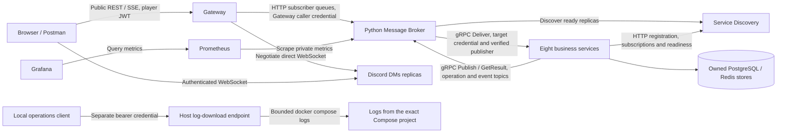

# Lab 4 configuration architecture

This diagram describes the Lab 4 Compose overlay and the shared messaging
contract. Use `docker-compose.yml` with `docker-compose.owned-broker.yml`.
The base alone retains the base-only configuration.

The optional Task 10 monitoring overlay adds Prometheus and Grafana. The Task 10
Broker samples registered services' live `/status.load` and prefers least utilization
when all eligible replicas have fresh measurements; otherwise it uses round robin.
These changes require reviewed Task 10 images; uninstrumented services remain explicit gaps.

Broker owns instance selection, round robin, circuit breaking, subscriber queues
and topic routing. Gateway authenticates public users and does not route internal
business APIs. DMs WebSocket traffic remains direct after negotiation; SSE remains
HTTP streaming. All gRPC ports and backend REST ports stay private, except the
browser-facing DMs WebSocket listeners. Receiver authorization remains mandatory.

The shared catalog selects gRPC for all eight consumer groups. Runtime compliance
requires compatible published images and a Broker bundling identical transport
choices. Task 9 durable queues/dead letters and all eight gRPC activations are now
merged into Broker dev. The Task 10 source changes add load-aware routing and the
monitoring overlay; neither a source diagram nor a merged PR proves publication
or running-stack acceptance. See the [Task 10 rollout](service-load-monitoring.md).
