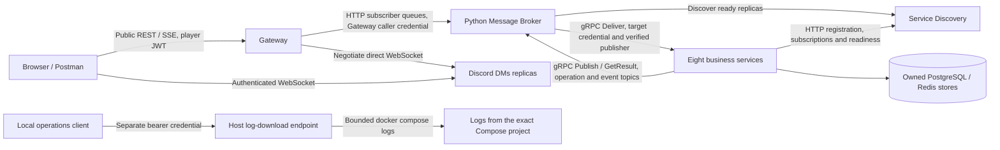

# Lab 4 configuration architecture

This diagram describes the Lab 4 Compose overlay and the shared messaging
contract. Use `docker-compose.yml` with `docker-compose.owned-broker.yml`.
The base alone retains the base-only configuration.

Broker owns instance selection, round robin, circuit breaking, subscriber queues
and topic routing. Gateway authenticates public users and does not route internal
business APIs. DMs WebSocket traffic remains direct after negotiation; SSE remains
HTTP streaming. All gRPC ports and backend REST ports stay private, except the
browser-facing DMs WebSocket listeners. Receiver authorization remains mandatory.

The shared catalog selects gRPC for all eight consumer groups. Runtime compliance
requires compatible published images and a Broker bundling identical transport
choices. The inspected Broker source still differs for Credential/Rules; see the
[configuration review](lab4-configuration-review.md). The diagram does not claim
that deployment gates, durable Broker queues, dead letters, load-aware routing or
a monitoring stack have been implemented or verified.
