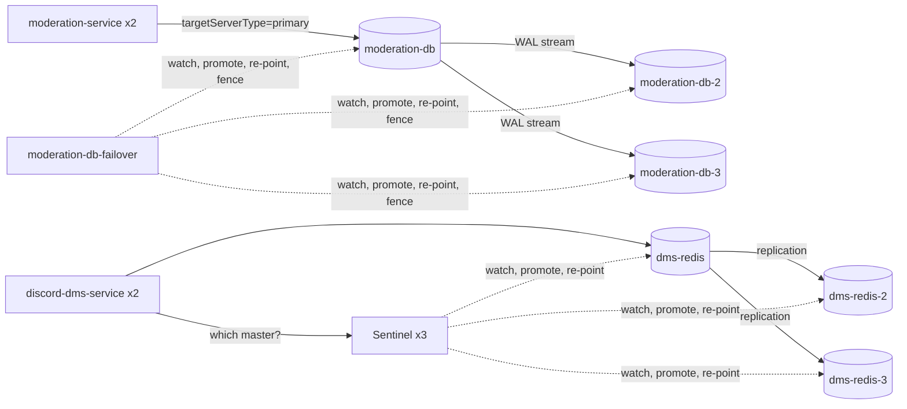

# Moderation and Discord DMs: database replication and failover (Lab 5)

Each owned private database runs as **three nodes** (a primary and **two replicas**), with
**automatic failover**. It is opt-in through `docker-compose.replication.yml`, uses only the
official `postgres:16-alpine` and `redis:7.4-alpine` images, and changes no other owner's
service.

| | Moderation | Discord DMs |
| --- | --- | --- |
| Database | PostgreSQL 16 | Redis 7.4 |
| Nodes | `moderation-db` (first primary), `moderation-db-2`, `moderation-db-3` | `dms-redis` (first master), `dms-redis-2`, `dms-redis-3` |
| Replication | Streaming replication (WAL), asynchronous | Redis replication, asynchronous |
| Failover by | `moderation-db-failover` (`docker/moderation-db/failover.sh`) | 3 Sentinels, quorum 2 (`dms-redis-sentinel-1..3`) |
| How the service finds the writer | JDBC URL lists all nodes with `targetServerType=primary` | Asks the Sentinels for the master (`REDIS_SENTINEL_ADDRS`) |
| Service version needed | `lab3-0.11.0`: failover errors become retryable 503 | `lab3-0.11.0`: Sentinel client |



## Moderation (PostgreSQL)

### Roles

Every node starts through `docker/moderation-db/node.sh`, which decides the node's role on
every start and then hands over to the image's own entrypoint:

| The node finds | It does |
| --- | --- |
| Empty data, and a primary elsewhere | Clones it with `pg_basebackup` and streams from it |
| Empty data, no primary, and it is `moderation-db` | Initialises the cluster (first start only) |
| A replica's data | Follows whichever node is primary now |
| A former primary's data, and another primary | It was failed over: discards its copy and re-clones, so it rejoins as a replica, never as a second primary |
| A former primary's data, and no other primary | Starts as primary, unless a peer is on a newer timeline; then it waits |

### Failover

The monitor checks every node every `CHECK_INTERVAL` (2 s). It acts on what it finds:

| It finds | It does |
| --- | --- |
| No primary for `FAILOVER_AFTER` (5) checks in a row | Promotes the replica that has received the most WAL (`pg_promote`) |
| A replica still pointing at a former primary | Re-points it (`primary_conninfo`, reload) |
| Two primaries (a former primary started without the boot check) | Fences the one on the older timeline (`default_transaction_read_only`), and ends its client sessions so applications reconnect to the real primary |

Restarting a fenced node makes `node.sh` re-clone it as a replica. Expect roughly 10 to 15
seconds without a primary.

### What Moderation sees

- **During the failover:** decisions and policy changes fail as retryable
  `503 DATABASE_UNAVAILABLE` with `Retry-After`, never as `500`.
- **After it:** the driver reconnects to the new primary without a restart.

### Credentials

`MODERATION_DB_REPLICATION_PASSWORD` is separate from the application's password:
- **On the nodes:** each node writes it to a libpq passfile outside the data volume. So it
  is never part of `primary_conninfo`, which PostgreSQL logs whenever it changes.
- **The role:** the monitor creates the `replicator` role on the primary, or updates its
  password. Its session never logs a failing statement's text.

### Adopting an existing database

An existing single-node `moderation-pg-data` volume is kept:
- `node.sh` adds the replication entry to `pg_hba.conf`;
- the monitor adds the role;
- the two replicas clone the existing data.

### Trade-off

Replication is asynchronous, so a write acknowledged in the last instant before the primary
crashes may not have reached a replica. The monitor promotes the most up-to-date replica, so
as little as possible is lost.

Synchronous replication would remove that loss. It would also block every write whenever no
replica is reachable, which is the wrong trade for this game.

## Discord DMs (Redis)

### Roles

The nodes start through `docker/dms-redis/node.sh`:
- **It asks the Sentinels which node is master now,** and starts as its replica, or as master
  when that is itself. A fixed `--replicaof` would re-attach a restarted node to the original
  master even after a failover.
- **On the very first start,** before any Sentinel knows the cluster, `dms-redis` is master.

### Failover

When two of the three Sentinels cannot reach the master for 5 s:
- **Promotion:** they elect a leader, which promotes the most up-to-date replica and re-points
  the other.
- **Rejoining:** a master that comes back is turned into a replica.

The Sentinels keep their configuration in their own volumes, so a restarted Sentinel
remembers the failover.

### What DMs sees

- **Client:** with `REDIS_SENTINEL_ADDRS`, `REDIS_MASTER_NAME` and `REDIS_SENTINEL_PASSWORD`,
  DMs uses a Sentinel client. New connections and its cross-replica pub/sub subscription
  follow the new master without a restart.
- **Without these settings,** DMs connects to `REDIS_ADDR` exactly as before.

**Credentials:** `DMS_REDIS_SENTINEL_PASSWORD` protects the Sentinels and is separate from
`DMS_REDIS_PASSWORD`. Both are written into generated configuration files, never onto a
command line.

## Run

Add `.env.replication.example`'s variables to the same private `.env`. Then:

```bash
docker compose --env-file .env -f docker-compose.yml -f docker-compose.owned-broker.yml \
  -f docker-compose.replication.yml up -d
```

Use the same three `-f` files in every command below, shown here as `$F`:

```bash
F="-f docker-compose.yml -f docker-compose.owned-broker.yml -f docker-compose.replication.yml"
```

### Show replication

```bash
# Moderation: the primary streams to two replicas.
docker compose $F exec moderation-db psql -U moderation -d postgres \
  -c "SELECT application_name, state FROM pg_stat_replication"
# DMs: the master has two replicas, and every Sentinel agrees on the master.
docker compose $F exec dms-redis redis-cli INFO replication
docker compose $F exec dms-redis-sentinel-1 sh -c \
  'REDISCLI_AUTH=$SENTINEL_PASSWORD redis-cli -p 26379 SENTINEL get-master-addr-by-name dms-redis'
```

### Show failover

```bash
# Moderation: kill the primary and watch the monitor promote a replica.
docker compose $F kill moderation-db
docker compose $F logs -f moderation-db-failover      # failover.promoted, replica.repointed
# Bring it back: it re-clones and rejoins as a replica.
docker compose $F start moderation-db

# DMs: kill the master and ask a Sentinel again; another node is master within seconds.
docker compose $F kill dms-redis
docker compose $F logs dms-redis-sentinel-1          # +switch-master
docker compose $F start dms-redis                    # comes back as a replica
```

Both services keep answering throughout. Moderation answers retryable 503s during its 10 to 15
seconds without a primary.

## Verification

This was run without Docker, using real PostgreSQL 16 and Redis processes on one machine. The
scripts in this PR ran unmodified, with the Moderation and DMs builds from their replication
branches.

### Moderation: 10/10 checks on a new cluster, 11/11 adopting an existing database

- **Replication:** a primary streams to 2 replicas, and a write through Moderation reaches both.
- **First failover:** the primary crashed (`pg_ctl stop -m immediate`). Writes sent from the
  moment of the crash got only `503` (about 11 s), then `201` on the promoted replica. Nothing
  committed before the crash was lost.
- **Recovery:** the other replica was re-pointed. The crashed primary restarted, re-cloned and
  rejoined as a replica.
- **Second failover:** it also succeeded, promoting the rejoined node.
- **Split brain:** a former primary started without the boot check was fenced read-only.
  Writes kept reaching the real primary, and once restarted through `node.sh` it rejoined.
- **Adoption:** an existing single-node database, created without any replication setup and
  holding data, was adopted. Its data reached both replicas.
- **Secrets:** no password appeared in any node, monitor or service log.

### DMs: 9/9 checks

- **Replication:** a master replicates to 2 replicas, and a write through DMs in Sentinel mode
  reaches both.
- **Failover:** the master crashed and was replaced in 3.3 s. The first write afterwards
  succeeded, earlier data was still served, and the pub/sub subscription moved to the new master.
- **Recovery:** the crashed master restarted as a replica and caught up. A replica restarted
  after the failover followed the new master.
- **Second failover:** also 3.3 s.
- **Secrets:** no password appeared in any log.

### Compose

`docker compose config` of the base, owned-broker and replication files (with placeholder
values and the `replicas` profile) is valid. Every node and Sentinel gets its role script,
identity and volumes, and both replicas of each service get the failover settings.

### Not verified

- **Containers:** these Compose services were not started, because Docker does not run on the
  verifying machine.
- **Windows stand-ins:** container start-up was replaced by a stand-in for the images'
  entrypoints, and the Redis nodes ran on IP addresses. The Windows Redis 5 build has no
  Sentinel host-name support, and cannot sync a replica that sets `replica-announce-ip`.
  Redis 7 in Compose uses both.
