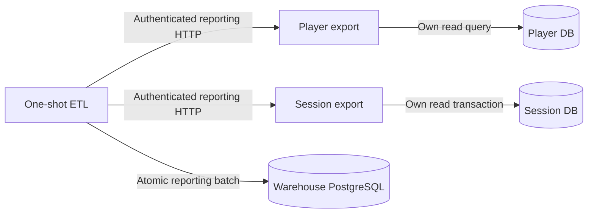

# Lab 5 Grade 4: service-owned exports and Warehouse ETL

Shared candidate tracked by CPR issue #170, Player #34 and Session #41. The owned
extension adds Credential inventory and Rules policy metadata to the initial
Player/Session configuration; see [the owned handoff](owned-warehouse-exports.md).
All eight services are now configured after the reviewed handoffs in #175/#176.
See [all-source rollout and verification](warehouse-all-sources.md). Configuration
does not claim full-team deployed acceptance or image publication. The PDF
numbers Warehouse/ETL as Grade 4; the earlier handoff title used Grade 3.

## Ownership and communication

The CPR's private-database ownership rule remains: ETL never receives business
database credentials, executes cross-service SQL or joins operational databases.
Each owner reads its own database and exposes a private reporting snapshot.
The **new operational reporting exception** is direct HTTP from the batch job to
`GET /internal/v1/analytics/snapshot`. It is read-only extraction, not live gameplay
traffic. Existing business HTTP/gRPC calls still use Broker. Do not add this route
to Gateway or change the business topic/protobuf catalog for reporting.

Use a distinct per-service `WAREHOUSE_EXPORT_TOKEN` (32-256 URL-safe characters).
It must differ from that service's business credential. Empty/malformed/reused
credentials disable export with 503 `EXPORT_NOT_CONFIGURED`; old deployments
and business behavior remain available. The ETL receives only these reporting
credentials, never JWT keys or database credentials for the private services.



## Wire contract, version 1

Request: GET without query/body, `Authorization: Bearer <reporting-token>` and
`X-Service-Name: warehouse-etl`. This route is private-network only; do not publish
backend ports for it. Responses use `Cache-Control: no-store`, JSON, and the
service's existing trace/error conventions. Wrong/missing credentials: 401;
wrong caller: 403; query parameters: 400 `INVALID_QUERY`; source/database failure:
503 `EXPORT_UNAVAILABLE`; overflow: 413 `EXPORT_TOO_LARGE`. Existing task deadline
and capacity errors can also apply. Exports share existing business admission.

```json
{
  "schemaVersion": 1,
  "source": "player-service",
  "capturedAt": "2026-11-23T12:00:00Z",
  "datasets": [{
    "name": "players",
    "records": [{
      "id": "11111111-1111-1111-1111-111111111111",
      "data": {"level": 1, "xp": 100, "shiftsCompleted": 1,
               "accuracyTotal": 1.0, "disciplinaryActions": 0}
    }]
  }]
}
```

This example is synthetic, not seeded production data. Each export is one
complete, consistent per-source snapshot, not a page or a delta. PostgreSQL
statement/transaction snapshots implement this in the owned services. Snapshot
times differ between services; no globally consistent multi-database snapshot is
claimed. No new gameplay records or ETL-specific business writes are generated.

- Maximum 10,000 records per response and 8 MiB at the ETL boundary. Owners must
  fail on overflow **before returning a partial snapshot**. Beyond lab-sized data,
  a coordinated versioned snapshot/cursor contract is required; truncation is unsafe.
- All configured datasets appear exactly once, including `records: []` when empty.
  Omission is an error, never interpreted as deletion.
- IDs are stable opaque strings, 1-128 ASCII letters/digits/`._:-`, unique within a
  dataset. Composite identities may use a stable opaque key. Never use email/name.
- UTC `capturedAt` is required; schema version and source must match configuration.
- `data` has exactly the field allowlist/types in `etl/sources.json`. Extra or missing
  fields, duplicate IDs/JSON keys, booleans in integer fields and nonfinite numbers
  reject the whole batch. Integer range is signed 64-bit. String values max 128
  characters; UUID fields must be nonzero UUID strings. Types: integer, number,
  string, uuid, boolean. No nullable fields in version 1.
- Never export password hashes, access/refresh tokens, signing keys, email,
  personal names, credential documents, chat contents or authorization assignments.

Player's `players` exports level, cumulative XP, completed-shift count, cumulative
accuracy and disciplinary count. Session's `sessions` exports team ID, difficulty,
state, processed count, score, penalties, ruleset version and revision. State values
come from the source; no invented completion timestamp or XP formula is introduced.

## Extraction, transformation and loading

The Python job reads `etl/sources.json` (override `ETL_SOURCES_FILE` for testing).
It fetches configured sources with independent tokens, no proxies/redirects,
two-second socket timeouts, bounded response size/read lifetime, and no automatic
retry. Before loading, transformation parses UTC timestamps, normalizes numeric
measures and UUIDs and flattens each approved dataset into stable reporting keys.
Two typed reporting views expose analytics-friendly column names. The job connects
only to its own Warehouse.

Each successful batch atomically inserts `warehouse_runs`, `warehouse_sources`
and `warehouse_records`. `current_warehouse_records`, `player_progression` and
`session_results` expose only the latest committed batch. Changes/deletions are
reflected by complete replacement of the current snapshot, including empty
datasets. Earlier snapshots remain for history (default last 30 batches;
`WAREHOUSE_RETAIN_RUNS` is 1..1000). Do not sum raw historical snapshots as if they
were distinct gameplay events. Business IDs and current views prevent that error.

A failed source, invalid schema, timeout or failed load rolls back the entire
batch and preserves current views. A PostgreSQL advisory lock rejects concurrent
jobs; it is not a distributed business transaction. Optional `ETL_RUN_ID` is a
nonzero UUID: replaying a successful run ID returns its result without extracting
or duplicating records. Reuse a run ID only for the same intended batch.

Warehouse data persists in `warehouse-data`. Historical records intentionally
retain deleted source IDs until retention removes those batches. This is not a
live source of truth and must not be used by game services for authorization.
History is a sequence of periodic observations, not a complete event audit:
records created and deleted between successful batches cannot be reconstructed.

## Run and verify

Add `.env.warehouse.example` values to an ignored private environment. Select
reviewed export-capable Player/Session images and a built/published ETL image.
No current release pin is silently upgraded. Local ETL image build:

```powershell
docker build -t student-id-warehouse-etl:local etl
```

Set `WAREHOUSE_ETL_IMAGE=student-id-warehouse-etl:local` for that local test only.
Then use the same Compose project/private environment as the existing stack:

```powershell
docker compose --env-file .env -f docker-compose.yml -f docker-compose.owned-broker.yml -f docker-compose.warehouse.yml config --quiet
docker compose --env-file .env -f docker-compose.yml -f docker-compose.owned-broker.yml -f docker-compose.warehouse.yml up -d warehouse player-service session-service
docker compose --env-file .env -f docker-compose.yml -f docker-compose.owned-broker.yml -f docker-compose.warehouse.yml run --rm warehouse-etl
docker compose --env-file .env -f docker-compose.yml -f docker-compose.owned-broker.yml -f docker-compose.warehouse.yml exec warehouse psql -U warehouse -d warehouse -c "SELECT * FROM session_results"
```

The job runs once and exits nonzero on failure. Run manually or schedule the same
command using cron/Task Scheduler; no scheduler service is required. Batch interval
is an operator choice. Do not use `down -v` when warehouse history must survive.
Warehouse has no published host port. Use separate least-privilege reporting users
for human dashboards; the ETL database user owns only the Warehouse database.

Source-mode tests (Python 3.12+): install `etl/requirements.txt` and coverage.
Set `ETL_TEST_DSN` **only to a disposable test database**, then:

```text
python -m coverage run --source=etl.run -m unittest discover -s etl/tests -v
python -m coverage report --fail-under=70
```

Tests use real HTTP peers and PostgreSQL to verify transactions, idempotency,
updates/deletion, history, concurrency and strict schema/authentication boundaries.
Owned-service suites test their real database-backed export handlers separately.

After building the three candidate images, run `python etl/verify_live.py` for
real-container acceptance. It creates a fresh isolated network and databases,
seeds synthetic rows, checks replay/updates/deletion and a stopped source, then
removes only the containers/network it created. It never starts the shared stack.
Its image arguments can select reviewed published candidates instead of local
tags. No end-to-end success is inferred from health checks alone.

## Teammate implementation handoff

1. Implement this exact reporting envelope and auth boundary in your own service.
2. Choose a minimal analytics field allowlist from actual owned data; supply stable
   IDs, exact types/units and deletion behavior. No invented mock business facts.
3. Return a complete coherent snapshot, including empty datasets; reject overflow.
   Keep existing deadlines, capacity, authorization and business transports intact.
4. Test auth failures, privacy, real data, updates/deletion, failure and overflow.
5. Send your schema, canonical endpoint address, source commit, passing tests and
   reviewed image tag. Share credential **variable names only**, never real tokens.
6. We add your reviewed configuration/schema entry and reporting view to the ETL,
   then verify extraction against your released service. Do not edit another
   owner's configuration entry or overwrite the shared job independently.

PostgreSQL supports consistent statement/transaction snapshots; the ETL uses
[Psycopg's binary distribution](https://www.psycopg.org/psycopg3/docs/basic/install.html).
